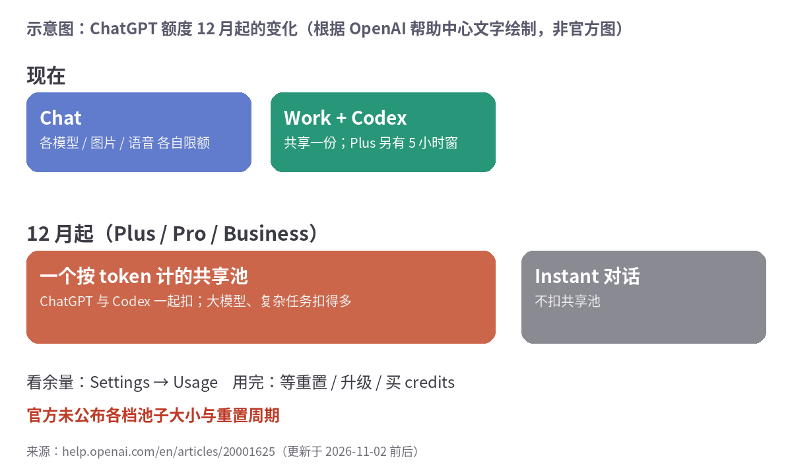

ChatGPT 和 Codex 要合池了。OpenAI 帮助中心那篇《Understanding ChatGPT and Codex usage limits》（11 月 2 日前后更新）写着：**12 月起**，Plus、Pro、Business 的用量在 ChatGPT 和 Codex 之间共享，按 token 计。

晚上让 Codex 跑一个长任务，第二天白天聊天能用的就少了，反过来也一样。我去，白天聊、晚上丢给 agent 干活的人，这下两头都撞上。

## OpenAI 写明了什么

- 模型越高级、任务越复杂，扣得越多。**Instant 对话不扣**这个池子。
- 余量和重置时间看 Settings → Usage。用完了三条路：等重置、升级、买 credits。
- 官方原话是预计"大多数用户"等重置的频率不会比现在更高。
- 价格不变。

没写的：每档池子**有多大**、**多久重置**、12 月**哪一天**切换、Free 和 Go 怎么算。所以"不会更频繁"这句，现在没法验证。

时间线上，10 月 29 日 OpenAI 刚把 Pro 100 / 500 的 Work 和 Codex 额度翻倍，Pro 200 原定的削减取消（这条来自 BleepingComputer 和 Sloane.ai 的整理，我没看到 OpenAI 单独公告）。前脚刚加，后脚合池，到底是加了还是减了，12 月才知道。

## Anthropic 这边

10 月 30 日（周五），Anthropic 把两个 Max 改名：$100 的 Max 5x 现在叫 **Max**，$200 的 Max 20x 叫 **Ultra**，老用户自动迁过去，价格没动。官方定价页现在这么写：

- Max：Pro 的 5 倍用量，**每 5 小时和每周**都按这个算；Fable 最多占周限额一半；每月 $100 API 额度。
- Ultra：**每周** Pro 的 10 倍；**验证过的账户没有 5 小时限额**；每月 $200 API 额度（Max 是 $100）。
- 周限额超了，可以开 usage credits，按标准 API 价继续算。

"验证"是自动的，看账户和付款记录，不能申请。新账户先有临时限额，解除了会发邮件（The Next Web 的报道）。

封面就是定价页截图，Ultra 卡片第一行写着 "No 5-hour limit"，旁边那个小十字号指向"verified accounts"。

## 下面是我瞎猜的

两家一起把 5 小时窗往外推，周额度却一个字没加。5 小时窗被骂得最多，拿掉它听着像发福利，可一周的总量还是那么多，跑得猛的人只是周三就见底，然后 usage credits 按 API 价接着扣。离谱的是这居然还挺合理。

12 月切换那周我先不买 credits，盯两天 Settings → Usage，看 Codex 一晚上能把条吃掉多少再说降不降档。

## 来源

- [OpenAI：Understanding ChatGPT and Codex usage limits](https://help.openai.com/en/articles/20001625-understanding-chatgpt-and-codex-usage-limits)
- [OpenAI：Managing usage with GPT-6 Astra in Work and Codex](https://help.openai.com/en/articles/20001516-managing-usage-with-gpt-6-astra-in-work-and-codex)
- [Claude 定价页](https://claude.com/pricing)（封面截图来源，2026-11-05 截取）
- [The Next Web：Claude Max 改名 Ultra](https://thenextweb.com/news/claude-ultra-max-plan-rename-five-hour-limit)
- [BleepingComputer：Pro 额度翻倍与合池](https://www.bleepingcomputer.com/news/artificial-intelligence/openai-says-its-doubling-pro-usage-limits-and-bringing-work-features-to-chat/)
