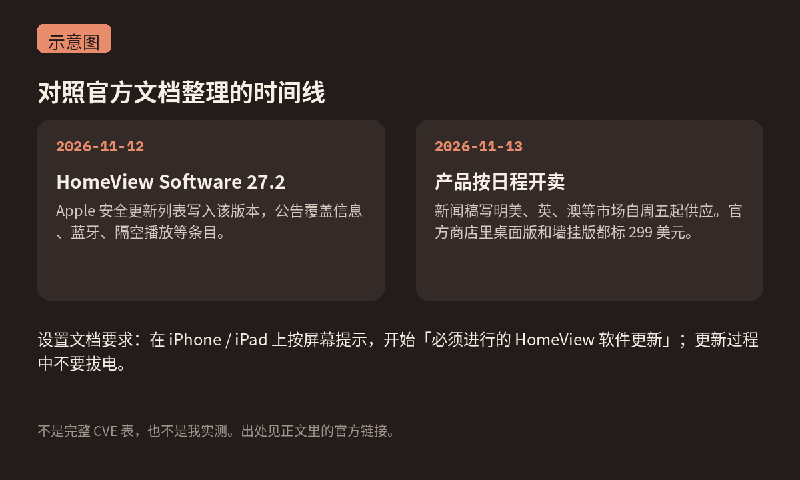

Apple 10 月 13 日的[新闻稿](https://www.apple.com/newsroom/2026/10/meet-apple-homeview-a-new-way-to-enjoy-entertainment-and-manage-the-home/)写得很清楚：HomeView 从今天（2026-11-13，星期五）起，在美国、英国、澳大利亚、加拿大、印度、新西兰、新加坡和南非开卖。桌面版和墙挂版在新闻稿里都是 **299 美元**。我今天打开[官方商店页面](https://www.apple.com/shop/buy-home/apple-homeview)，四个颜色也还是这个标价。

它的第一份系统安全更新来得更早一天。[Apple 开发者发布列表](https://developer.apple.com/news/releases/)里，**HomeView Software 27.2**（构建号 24V526）的日期是 2026-11-12。[安全更新总表](https://support.apple.com/zh-cn/100100)同一天把这条写了进去，适用设备就是 Apple HomeView。

我没有这台机器，也没有用 iPhone 走过设置。下面只对照官方文档。

<small>示意图，按官方新闻稿与安全公告整理，不是产品实拍或设置截图。</small>

## 设置文档里写了「必须进行的软件更新」

官方[设置说明](https://support.apple.com/zh-cn/122786)的步骤是：用自己的 iPhone 或 iPad 打开家庭 App，确认自己是家庭的 Resident（Owner），接通电源，把已解锁的手机或平板放到 HomeView 前面。接着有一句写得很硬：在 iPhone 或 iPad 上按屏幕提示，开始 **required HomeView software update**（必须进行的 HomeView 软件更新），**更新过程中不要拔电**。配置耗时可能不一样。更新完成后，再按屏幕提示继续。

设置文档要求 iPhone 是 **iOS 27.2 或更高版本**；iPad 那一行写的是 iPadOS 27 或更高版本。[技术规格页](https://www.apple.com/apple-homeview/specs/)则把系统要求写成：HomeView 使用最新软件，iPhone 为 iOS 27.2 或更高版本，iPad 为 **iPadOS 27.2** 或更高版本，并需要 Wi-Fi。两处对 iPad 最低版本的写法不完全一样，我按页面原样记下，不替它改。

后续怎么更新，另有一篇[专门说明](https://support.apple.com/zh-cn/149085)，发布日期也是 2026-11-12：默认会自动安装系统更新；也可以在配对的 iPhone / iPad 家庭 App 里，或在 HomeView 自己的设置 → 系统 → 软件更新里手动装。官方写了，更新完成前要保持接通电源。

设置文档没有写出厂预装的版本号。网上有文章说机器带着较旧的系统出门，我没在官方页面上看到对应表述，所以不写进去。能确定的是：设置流程里有一次必做的软件更新，而 27.2 是 11 月 12 日已经公布的安全版本。

<small>示意图，对照上述官方文档整理；不是完整 CVE 表，也不是我实测。</small>

## 27.2 公告里几条比较扎眼的条目

完整条目在[这篇安全公告](https://support.apple.com/zh-cn/149851)里，发布日期 2026-11-12。我按官方 Impact 原意转述，没有去复现。

跟**信息 / iMessage 群聊**有关的两条，和 11 月 9 日那轮 iPhone、Mac 补丁是同一组编号：

- 远程攻击者可能加入 iMessage 群聊并收到其中的消息（CVE-2026-113961）。
- 被拉进群的人，可能看到自己入群之前的消息（CVE-2026-113960）。

蓝牙和隔空播放这边也几乎对得上：蓝牙范围内可能绕过配对码尝试次数限制，甚至在没有用户交互的情况下完成配对；同一网络上也可能绕过 AirPlay 配对码次数限制。对应 CVE 是 2026-113964、113965、113968、113969。蓝牙还有一条内存损坏（CVE-2026-113970）。另外还有 App Intents（CVE-2026-113963，应用可能访问敏感用户数据）和 brotli（CVE-2026-111497，处理恶意构造的输入可能导致内存损坏）。

这些编号我 11 月 11 日写[iOS / macOS 27.2.1 那篇](/posts/2026/11/11/apple-security-updates-27-2-1/)时已经对照过当时的官方公告。今天新的只是：同一批问题，出现在这台 11 月 13 日开卖的设备的 27.2 公告里。

规格页还写了，这块屏是 7 英寸 Liquid Retina，芯片是 A18。新闻稿里的墙挂版另外要买支架，USB-C 墙插支架标价从 59.95 美元起，交流电接线支架从 79.95 美元起；PoE 那款写的是 2027 年初，129.95 美元。这些都来自官方页面，不是我经手买过。

我的理解（推断）：今天能拿到机器的人，真正该盯住的不是开箱视频，而是设置时那次必装更新，以及之后家庭 App 里的软件更新开关。至于你手上的机器出厂是不是已经带着 27.2，官方设置文档没写，我也没条件去验证。
