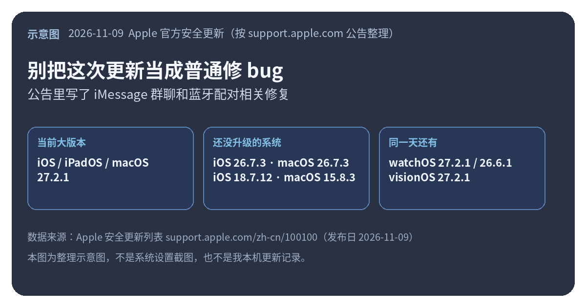
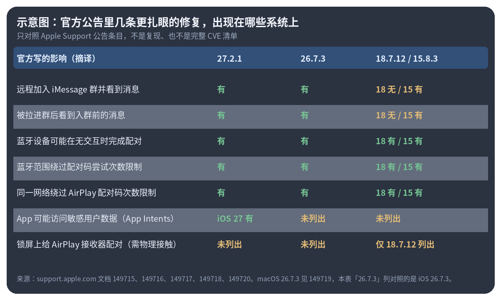

Apple 在 2026-11-09 又推了一轮小版本更新。清单在官方的 [Apple 安全更新列表](https://support.apple.com/zh-cn/100100)里，这份列表页的发布日期是 2026-11-10。当前大版本写成：**iOS / iPadOS 27.2.1**、**macOS 27.2.1**（Golden Gate），同一天还给没升上去的系统补了 **iOS / iPadOS 26.7.3**、**iOS / iPadOS 18.7.12**、**macOS Tahoe 26.7.3**、**macOS Sequoia 15.8.3**。Watch 和 Vision Pro 也在同一天的名单里：watchOS 27.2.1、watchOS 26.6.1、visionOS 27.2.1。

我没拿自己的 iPhone 或 Mac 装过这些包，也没有复现任何漏洞。下面只整理官方安全公告里写明的条目。

<small>示意图，按 [Apple 安全更新列表](https://support.apple.com/zh-cn/100100) 整理，不是系统设置截图。</small>

## 公告里几条比较扎眼

iOS 27.2.1 的说明在 [这篇](https://support.apple.com/zh-cn/149715)。里面两条跟 **信息 App / iMessage 群聊**有关：

- 远程攻击者可能加入 iMessage 群聊并收到其中的消息（CVE-2026-113961）。
- 被拉进群的人，可能看到自己入群之前的消息（CVE-2026-113960）。

这不是我吓唬人，是 Apple 自己写的 Impact。同样两条也出现在 [iOS 26.7.3](https://support.apple.com/zh-cn/149716)、[macOS 27.2.1](https://support.apple.com/zh-cn/149718)、[macOS 26.7.3](https://support.apple.com/zh-cn/149719) 和 [macOS 15.8.3](https://support.apple.com/zh-cn/149720) 的公告里。但 [iOS 18.7.12](https://support.apple.com/zh-cn/149717) 那篇 **没有列出** 这两条——适用设备也更窄，只写了 iPhone XS、XS Max、XR 和第七代 iPad。

蓝牙和隔空播放这边，几条系统几乎对得上：蓝牙范围内可能绕过配对码尝试次数限制，甚至在没有用户交互的情况下完成配对；同一网络上也可能绕过 AirPlay 配对码次数限制。对应 CVE 是 2026-113964、113965、113968、113969。蓝牙还有一条内存损坏（CVE-2026-113970）。这些在 27、26、18、15 的公告里都有。

另外两个别混在一起：

- **App Intents**（CVE-2026-113963，应用可能访问敏感用户数据）只出现在 iOS 27.2.1 的公告里，26.7.3 和 18.7.12 没写。
- **锁屏上给 AirPlay 接收器配对**（CVE-2026-113971，需物理接触）只出现在 iOS 18.7.12 的公告里。

还有 brotli：各系统公告都写了「处理恶意构造的输入可能导致内存损坏」。macOS 那几篇标了 CVE-2026-111497，iOS 27.2.1 / 26.7.3 写了同类问题，但页面上没挂 CVE 编号。我按页面原样记，不替它补号。

<small>示意图，对照上述官方文档整理；「26.7.3」这一列看的是 iOS 26.7.3，macOS 26.7.3 的 Messages 等条目与它一致。不是完整 CVE 表，也不是我实测。</small>

## 怎么更新，以及我没写进去的东西

iPhone、iPad 走「设置 → 通用 → 软件更新」，Mac 走「系统设置 → 软件更新」。总入口还是上面那份 [安全更新列表](https://support.apple.com/zh-cn/100100)，里面也链到了各系统的更新说明。官方还写了一句：iOS、iPadOS、tvOS、watchOS、visionOS 装完 **不能降回上一版**。

名单里这次没看到新的 tvOS 安全公告。截至 11 月 10 日这份列表，tvOS 的当前版本仍写着 27.2（10 月 26 日那一档）。Watch 和 Vision Pro 的条目我没有逐条展开，要核对请直接打开列表里的对应文档。

我的理解（推断）：这轮不是功能更新，弹窗看起来不起眼，但公告里的群聊和配对条目，值得把它装上。至于你的机器是不是正在被打，官方没说，我也没条件去验证，别把这篇当成出事通报。
