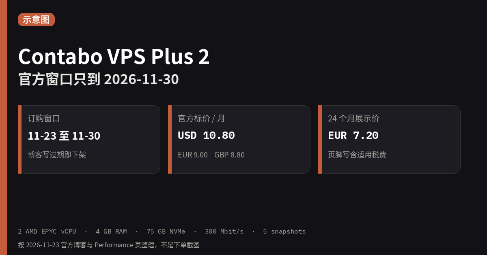
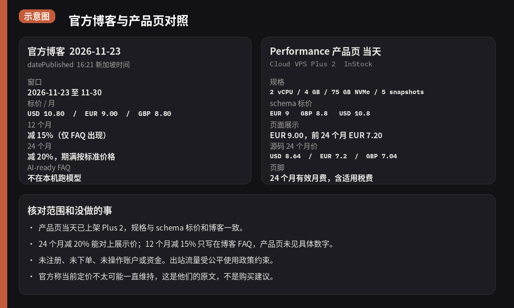

[Contabo 官方博客](https://contabo.com/blog/black-friday-2026/) 今天发了一篇 Black Friday 说明，标题写成：拿一周 VPS Plus 2，并且可以按今天的价格锁最长两年。页面结构化数据里的 datePublished 是 **2026-11-23T08:21:35+00:00**，换成新加坡时间是 **2026-11-23 16:21**。dateModified 只比它晚了三秒。作者栏写的是 Christopher Carter，组织是 Contabo GmbH。

这不是软件更新，我也没有在这台机器上装任何东西。没有注册，没有下单，更没有动账户或资金。我只是把官方博客和当天的 [Performance VPS 产品页](https://contabo.com/en/vps-performance/) 对着看了一遍。

<small>示意图，按官方博客与 Performance 产品页整理，不是 Contabo 下单页截图，也没有使用他们的宣传图。</small>

## 官方把这档写成只卖一周

博客把 **VPS Plus 2** 写成 Performance VPS 的新入门档。订购窗口写得很死：**2026 年 11 月 23 日（周一）到 11 月 30 日（周一）**，过了就下架。规格是 2 个 AMD EPYC vCPU、4 GB 内存、75 GB NVMe、300 Mbit/s 端口、5 个快照。标价是每月 **$10.80 / €9.00 / £8.80**。

FAQ 又把同一组规格和窗口重复了一遍，并且写：要是还在权衡，就得在这一周内下单，Black Friday 周末一结束，这档会撤掉。长期合约折扣也写进了 FAQ：签 **12 个月减 15%**，签 **24 个月减 20%**。这是合约期里的折扣，**合约结束后按标准价格**。新客户和现有客户都可以在这一周用 12 或 24 个月合约去锁“今天的价格”。他们自己还写了一句：受市场影响，当前定价不太可能一直维持。那是官方原文，不是我的判断，我也懒得替谁决定要不要签。

博客把这档标成 AI-ready。同一篇 FAQ 直接问「Does VPS Plus 2 run AI models?」，回答是 **No**：应用跑在这台 VPS 上，再通过 API 去调你选定的模型，服务器本身不跑模型。需要把模型放在同一台机器上的，官方让换别的方案。我按原文记下，没有拿它当评测。

## 产品页当天已经能对上

打开官方 Performance 页，页顶先看到一句：Get VPS Plus 2 this Black Friday，长期方案最高减 20%，旁边带着倒计时。往下已经出现 **Cloud VPS Plus 2**，明细是 2 个 AMD EPYC vCPU、**4 GB RAM**、75 GB NVMe、5 个快照、300 Mbit/s 端口、不限流量（带星号）。这些和博客对得上。

同一页的产品结构化数据把 Cloud VPS Plus 2 写成 **InStock**，描述同样是 2 vCPU、4 GB RAM、75 GB NVMe、300 Mbit/s、5 个快照。offers 里的 lowPrice 是 **EUR 9、GBP 8.8、USD 10.8**，和博客标价一致。

卡片上我看到的是 **€9.00**，以及标成「前 24 个月」的 **€7.20** / month。页脚解释：展示价是 **24 个月订阅的有效月费，含适用税费**。€7.20 正好是 €9.00 减 20%，跟博客里 24 个月减 20% 对得上。页面源码里还有一组 24 个月价：`USD 8.64`、`EUR 7.2`、`GBP 7.04`。我没有在浏览器里把货币切到美元或英镑，12 个月减 15% 的具体数字也没出现在这张产品页上，所以那一档我只引用博客，不自己补算。

页脚另外写了几条约束：初始合约最短 **1 个月**；预付没有取消通知期，后付的取消通知期是 4 周；入站流量不限，出站流量也不限，但受公平使用政策约束，异常或干扰性用量可能被限速。1-click 应用里额外的开源软件，官方写由最终用户自己维护。至于升到更大的 Performance VPS、加 Storage Extension，博客说可以在 Customer Control Panel 里做，Storage Extension 是付费附加项。这些按钮我都没有实际点过。

<small>示意图，按 2026-11-23 查阅的官方博客与产品页整理，不是结账截图。</small>

## 我没核对的部分

账户没创建，订购和支付步骤也没走进去，所以完整合约文本、实际怎么扣费、税费会不会因地区再变，这次都没核对。12 个月 15% 只出现在博客 FAQ 里，产品页当天展示的是 24 个月有效月费。官方还提到 Auto Backup 和一批 1-click 应用，我没有逐个点开。

要不要签 12 或 24 个月，这里不给建议。能确定的，只有官方自己写清的窗口、标价，以及「合约结束后回到标准价格」。
