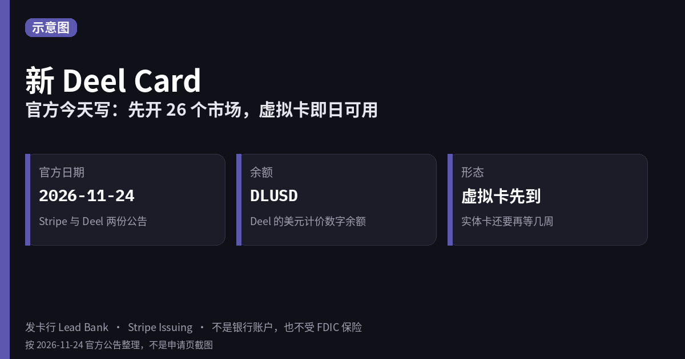
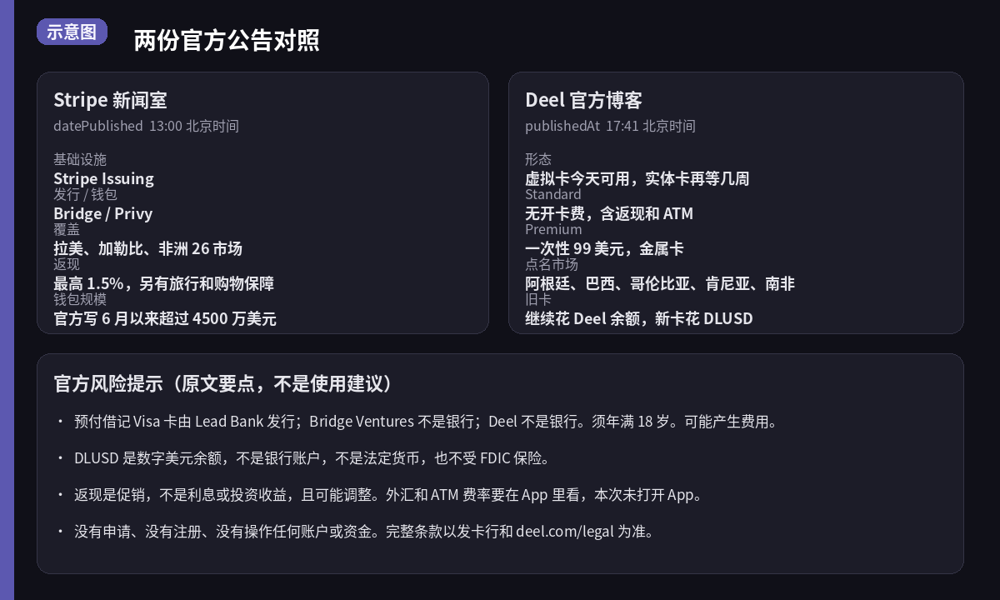

[Stripe 新闻室](https://stripe.com/newsroom/news/stripe-powers-new-deel-card-that-lets-contractors-spend-their-earnings-in-stablecoins-globally) 今天发了一篇公告，说 Deel 用 Stripe Issuing，让承包商能拿稳定币余额去花新的 Deel Card。页面日期写成 **November 24, 2026**。结构化数据里的 datePublished 是 **2026-11-24T00:00-05:00**，换成北京时间是 **13:00**。这个钟点看着像美国东部时间的日期零点，我主要拿它当日期，不把它当成精确发稿时刻。

同一天 [Deel 自己的博客](https://www.deel.com/blog/introducing-new-deel-card/) 也上了《The new Deel Card》。页面上的 Last Update 是 **November 24, 2026**。文章对象里的 publishedAt 是 **2026-11-24T09:41:23.503Z**，换成北京时间是 **17:41**。作者栏写 Valeriya Yordanova。

我没有 Deel 账户，也没去申请这张卡，更不会去动任何资金。下面只把两份官方说明里能对上的事实，以及他们自己写下的限制，摊开来说。

<small>示意图，按 Stripe 新闻室与 Deel 官方博客整理，不是 App 或发卡页截图，也没有使用他们的宣传图。</small>

## 这张卡花的是 DLUSD，不是把 USDT 直接刷出去

先把余额这件事说清楚。两边写的都是：承包商把收入放进 Deel 上的稳定币钱包，里面的余额叫 **DLUSD**，也就是 Deel 自己的美元计价数字余额。新卡从这笔余额扣款。线上和线下，只要 Visa 能用就可以花，商户收到的是当地货币。

底层怎么搭的，Stripe 写得更细：用 Bridge 发行这种稳定币，用 Privy 做钱包。隐私那一段他们是这么说的：余额和支付活动对公众不可见，靠 Privy 和 Tempo Zones 的集成，钱包只对持卡人、以及作为 Zone 运营方的 Deel 可见。链上实际情况我没有自己去查。

钱包里已经放了多少，两边都引了同一句话。Stripe 转述 Deel 的 Head of Crypto Thierry Edde：今年 6 月上线稳定币钱包以来，承包商已经放了超过 **4500 万美元**。Deel 自己的博客也写了这个数字，并再次确认钱包是 6 月推出的。

## 26 个市场，虚拟卡今天就能加到手机里

覆盖范围能对上：先在拉丁美洲、加勒比和非洲的 **26 个市场** 上线。Deel 只点名了阿根廷、巴西、哥伦比亚、肯尼亚和南非，并说还会再加市场。剩下那 21 个名字，两份公告都没列全，我也不补。

卡的形态是 Deel 写明白的。**虚拟卡今天就能用**，可以先加到 Apple Pay 或 Google Pay。实体卡，包括 Premium 那张金属卡，还要再等几周。实体卡寄到之后，才能在全球 ATM 取现。消费限额和单笔限额可以自己设，余额、返现和卡控制都在 Deel App 里。

档位也是他们定的。Standard **没有开卡费**，带返现、全球 ATM，还有旅行和购物保障。Premium 要一次性交 **99 美元**，换成金属卡，返现和保额都更高。他们还算了一笔账：按每月返现上限，Premium 的开卡费不到五个月就能被返现盖掉。这是官方自己的口径。完整权益、外汇和 ATM 费用，他们让去 App 里看。我没打开 App，这笔账也没替他们复核。

符合条件的消费，两边都写最高 **1.5%** 返现，按月发放。Deel 举例包括软件订阅、共享办公、日用品，还有请客户吃饭。Stripe 另外提到旅行和购物保障。这些都是产品说明，不是我用过的体验。

已经有旧 Deel Card 的人，Deel 说那张卡不会变。旧卡继续花 Deel 余额，新卡花 DLUSD。App 里会按余额标出来，例如 Deel Card USD 和 Deel Card DLUSD。旧卡在美元、欧元、英镑和另外七种主要货币下的国际消费不收外汇加价——这是旧卡条款里的写法，不是我去测过的结果。

申请门槛他们写成：KYC 已经做完、在 Deel 上通过验证，再阅读并接受持卡条款就能激活，不用另开银行，也不用再填一份单独申请。这是流程说明。这些步骤我都没走。

## 官方自己列出的限制，最好先看完

两份公告末尾几乎是同一段法律说明。我不把它改成更好听的承诺，只按原文要点记在这里：

预付借记 Visa 卡由 **Lead Bank** 在 Visa U.S.A. Inc. 授权下发行。**Bridge Ventures LLC** 是金融科技公司，不是银行，作为项目经理（Program Manager）代 Lead Bank 管理和运营这张卡。**Deel 不是银行**。Stripe 把 Deel 写成金融科技公司，Deel 自己的博客写成 technology company，负责申请、访问和卡片管理。须年满 **18 岁** 才有资格。**可能产生费用**。

**DLUSD 是数字美元余额，不是银行账户，不是法定货币，也不受 FDIC 保险。** 稳定币功能由持牌第三方提供，而且取决于资格。返现是促销，**不是利息，也不是投资收益**，以后还可能调整。Visa 权益以发卡行条款为准，可能有除外情形。Deel 还指向 [deel.com/legal](https://www.deel.com/legal)。

所以别把它理解成“稳定币自动变成一张普通银行卡”。能不能申请、你所在的地方能不能用、实际扣费和外汇成本是多少，都要以发卡行条款和 App 里的费率为准。这里只记录官方今天公开写出的内容，不构成开卡、持有或使用建议。

<small>示意图，按 2026-11-24 的 Stripe 新闻室与 Deel 官方博客整理，不是申请页或 App 截图。</small>
