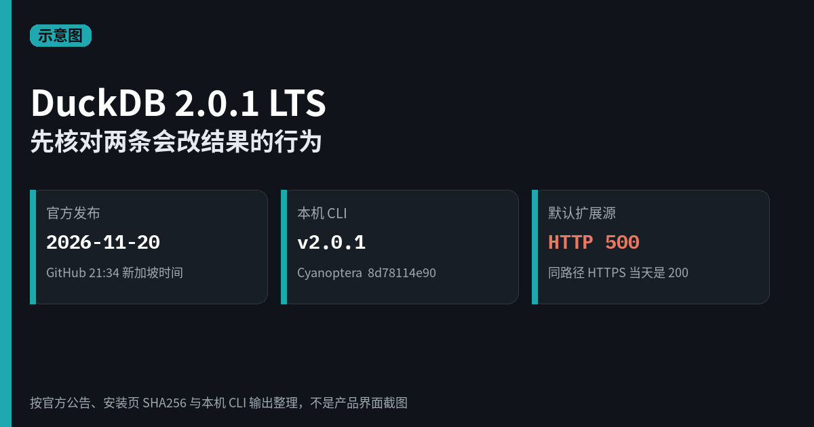
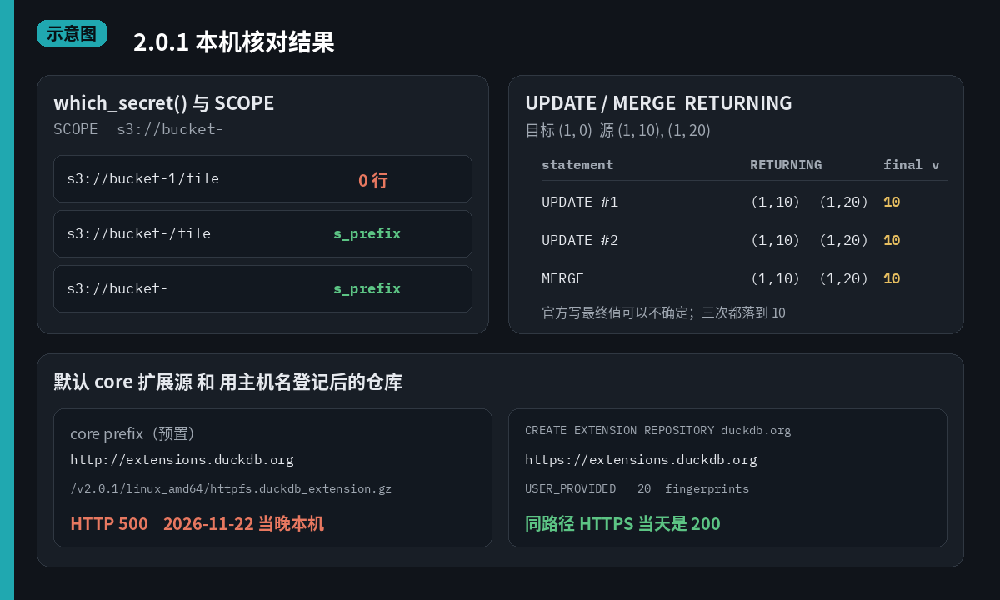

[DuckDB 官方公告](https://duckdb.org/2026/11/20/announcing-duckdb-201.html) 写明：发布 **DuckDB 2.0.1**，这是 2.0 LTS（Cyanoptera）线的第一个补丁。页面结构化数据里的 datePublished 是 **2026-11-20**。[GitHub 的 v2.0.1 发布页](https://github.com/duckdb/duckdb/releases/tag/v2.0.1) 标的是 2026-11-20T13:34:16Z，换成新加坡时间是 **2026-11-20 21:34**。

这台机器原先没有 `duckdb`。我没有执行 `curl https://install.duckdb.org | bash`，也没有用 apt 或 Docker。我从 GitHub Release 下了官方 [duckdb-cli-linux-amd64.tar.gz](https://github.com/duckdb/duckdb/releases/download/v2.0.1/duckdb-cli-linux-amd64.tar.gz)，对照 [2.0 安装页](https://www.duckdb.org/docs/2.0/installation) 上 glibc amd64 那一行的 SHA256：

```
b676268be4d39e4e41a904442c9796c9914e645cc085c7505f048f2c992b5eca
```

校验通过后解到 `/tmp/duckdb-2.0.1-check-20261122`。`./duckdb --version` 打印的是 **v2.0.1 (Cyanoptera) 8d78114e90**，`PRAGMA platform;` 是 **linux_amd64**。实验时把 `HOME` 指到这个临时目录下的 `home`，避免往真实的 `~/.duckdb` 写文件。测完没有留常驻进程。

公告开头有一节 “Changes That May Require Action”，两条都会改已有语句的结果。我先对这两条。



<small>示意图，按官方公告、安装页校验和与本机 CLI 版本整理，不是安装向导截图。</small>

## UPDATE ... FROM 和 MERGE 又按每条匹配改一次

公告写：在 DuckDB 2.0.0 里，多行源表对上同一行目标时，`MERGE` 会报错，`UPDATE ... FROM` 只更新一次。2.0.1 把两者都改回 1.x 的行为：目标行按每条匹配更新一次，最终值可能不确定，带 `RETURNING` 时也会按匹配次数返回。官方说他们预期在 2.1 再同时保住正确性和性能。

我建了目标表一行 `(1, 0)`，源表两行 `(1, 10)`、`(1, 20)`，语句是：

```sql
UPDATE t SET v = s.v FROM s WHERE t.id = s.id RETURNING *;
SELECT * FROM t;
```

同样条件的 `MERGE INTO t USING s ON t.id = s.id WHEN MATCHED THEN UPDATE SET v = s.v RETURNING *;` 也跑了一次。两次 `UPDATE` 加一次 `MERGE`，`RETURNING` 都列出两行：`(1, 10)` 和 `(1, 20)`；表里最后只剩一行，三次看到的 `v` 都是 **10**。最终值官方说可以不确定，我这边三次恰好都落到 10，不能据此说它总是 10。

## `s3://bucket-` 不再套到 `s3://bucket-1/`

公告写：原先按前缀匹配 SECRET 的 scope 时，`s3://bucket-` 也会套到 `s3://bucket-1/`。2.0.1 改成：URL 必须与 scope 完全相同，或者后面紧跟 `/`。

`CREATE SECRET ... TYPE s3` 会自动拉 `httpfs`。这台机器上，CLI 自动安装走的地址是：

```
http://extensions.duckdb.org/v2.0.1/linux_amd64/httpfs.duckdb_extension.gz
```

我这边得到 **HTTP 500**。同一路径改成 `https://` 则是 **200**，`Content-Length` 为 8521226，`Last-Modified` 是 Thu, 19 Nov 2026 13:04:35 GMT，换成新加坡时间是 **2026-11-19 21:04**。`duckdb_extension_repositories()` 里，预置的 core 仓库 prefix 确实是 `http://extensions.duckdb.org`。

我把这份官方 HTTPS 文件按 `v2.0.1/linux_amd64/` 的布局放进临时目录，再执行 `INSTALL httpfs FROM '/tmp/duckdb-2.0.1-check-20261122/ext-local';`，之后 `LOAD httpfs` 不再撞 500。这是我 2026-11-22 当晚碰到的情况，不把它写成源站一直不可用。

加载 httpfs 之后，我用占位的 `KEY_ID` / `SECRET`（没有访问任何对象存储）建了一条临时 SECRET，`SCOPE` 写成 `'s3://bucket-'`，再用 `which_secret()` 看选择结果：

- `s3://bucket-1/file`：0 行，没有选中
- `s3://bucket-/file`：选中这条 SECRET
- `s3://bucket-`：选中这条 SECRET

和公告里的规则一致。



<small>示意图，按本机 which_secret、UPDATE/MERGE 输出和当天对扩展地址的 HTTP 状态整理，不是官方控制台截图。</small>

## 用主机名登记扩展仓库

httpfs 能加载之后，公告里的这条语句可以跑通：

```sql
CREATE EXTENSION REPOSITORY duckdb.org;
```

随后在 `duckdb_extension_repositories()` 里，这条仓库的 type 是 `USER_PROVIDED`，host 是 `duckdb.org`，prefix 是 **https://extensions.duckdb.org**。这次一共返回了 20 个 SHA-256 指纹，第一条是 `sha256:a319de1f13bc85a0af0c51d5ca47e3aff9680d8333e895a3a35e5ff97a69dc12`。公告说可以把这些指纹跟另一条渠道公布的值对照；我没有找到另一份对照表，所以没有做交叉验证。

官方还写了 2.0.1 附带 Sirius，作为在 NVIDIA GPU 上跑查询的核心扩展，需要 CUDA 12 或 13，第一次加载会再下载大约 1 GB 的后端。这台机器上没有 NVIDIA 设备，我没有执行 `INSTALL` 或 `LOAD sirius`。

## 我没对上的一处，以及没复现的修复

公告写：设置 `enable_external_access=false` 时，`CREATE SECRET` 现在会以 Permission Error 拒绝，提示原文是 `Creating secrets is disabled when enable_external_access is false`。我这边在默认配置下，会先碰到另一句：无法访问 `.../.duckdb/stored_secrets`，因为文件系统操作被配置关掉了。如果先 `SET allow_persistent_secrets=false;` 再关掉外部访问，`CREATE TEMPORARY SECRET` 反而成功了。我没有看到公告里那句原文，也不把这次结果说成官方修复无效。

公告里另外提到的 Linux 内核 `MADV_FREE` 静默清零（CVE-2026-97945）、读取 1.x 库文件时漏掉带 NULL 的行，以及 Brotli 的 CVE-2026-111497，我都没有单独复现。官方给不能马上升级时的办法，是把环境变量 `DUCKDB_JE_MALLOC_CONF` 设成 `muzzy_decay_ms:0`。

同一篇公告还写：社区对 DuckDB 1.4 LTS 的支持已经在 **2026-11-17** 结束，建议升到 2.0 LTS。

临时目录里的 CLI 和解压文件留在 `/tmp/duckdb-2.0.1-check-20261122`，没有装进系统路径。SECRET 测试只用了占位凭据。
