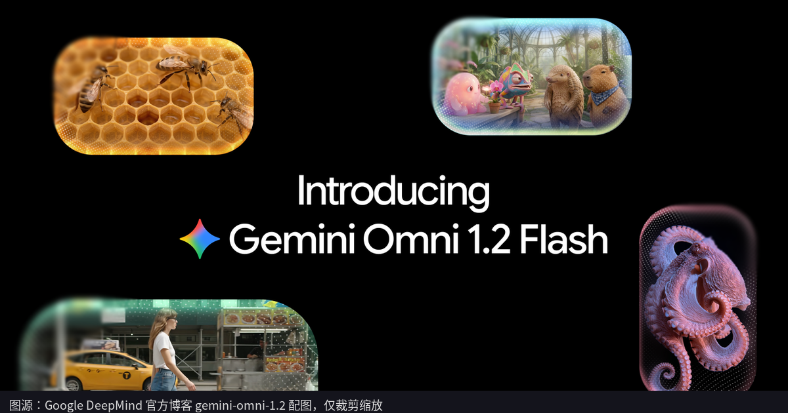
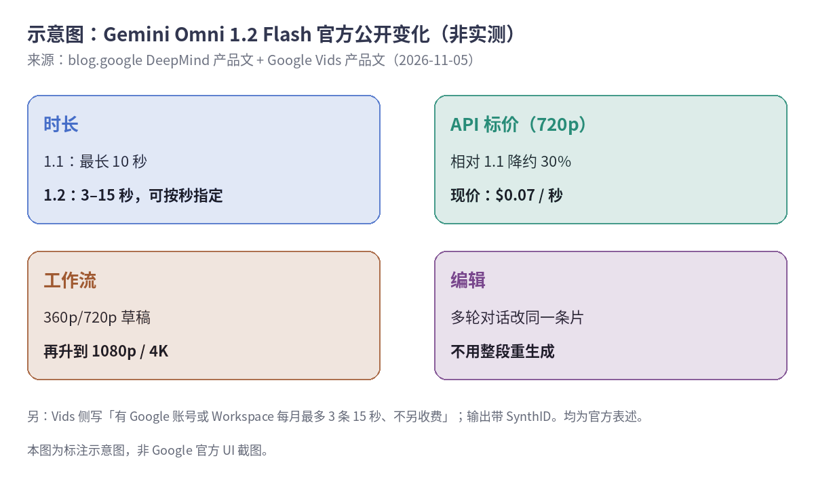

Google DeepMind 在 [2026-11-05 的产品文](https://blog.google/innovation-and-ai/technology/developers-tools/introducing-gemini-omni-1-2-flash/)里宣布：**Gemini Omni 1.2 Flash** 在 Gemini API 和 Google Cloud 上正式可用（generally available）。同一天 [Google Vids 的产品文](https://blog.google/products-and-platforms/products/workspace/omni-1-2-flash-google-vids/)也跟上了。

我没在 API 或 Vids 里实际生成过片子，下面只整理官方写明的变化。

<small>图：[Google DeepMind 官方博客](https://blog.google/innovation-and-ai/technology/developers-tools/introducing-gemini-omni-1-2-flash/) 配图（storage.googleapis.com 上的 gemini-omni-1.2 图），仅裁剪缩放并加了来源条。</small>

## 官方列了什么新东西

DeepMind 那篇里，我先盯了几处硬信息：

时长这边，原生生成和编辑最长 **15 秒**（1.1 写的是 10 秒），还能按 1 秒步进在 3–15 秒之间指定。价格写得很直白：相对 Omni 1.1 **降约 30%**，720p 标价 **每秒 0.07 美元**。

工作流上，官方建议先用 360p / 720p 草稿，满意了再升到 1080p 或 4K；同一条片还能多轮对话改，不用整段重跑。参考一致性那段是厂商自述——可以叠角色 / 产品图、最长约 3 秒的动作片段和音频提示，说脸、服装、包装字、品牌色更稳。我没复现，当宣传听。文末还写了输出带不可感知的 **SynthID**。

<small>示意图，按上述两篇官方文整理，不是 Google 界面截图，也不是我实测。</small>

## Vids 那边怎么写

Vids 那篇说：从当天起，有 Google 账号或 Google Workspace 订阅的人，在 Vids 里**每月最多生成 3 条 15 秒视频、不另收费**。入口写的是 [vids.new](https://vids.new/)。

另外，DeepMind 文还提到 Flow、Gemini App（写的是向 Google AI Ultra 订阅者滚动放出）、Google Ads 等入口。各产品额度是否共用，文里没写死——我这边也不瞎猜。

## 我读下来的取舍（推断）

如果只是想试水，Vids 的「每月 3 条」门槛低，不必先开账单。真要批量做广告素材、要稳定的分辨率和计费，才看 API / Cloud 那条线，并把「每秒 0.07 美元」按片长自己乘一下。

官方也老实写了还在改：快速运动、剧情大改、复杂物理这些还要继续补。所以别把发布文当成「已经全能」。

想核对原文，就去上面两篇 blog.google；开发文档和定价页也在 DeepMind 文末给了入口。
