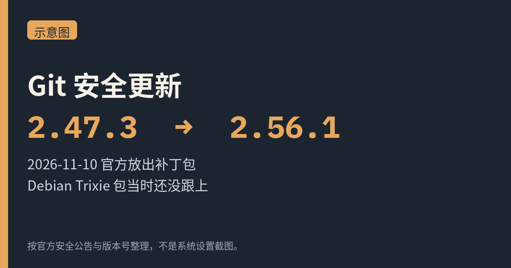
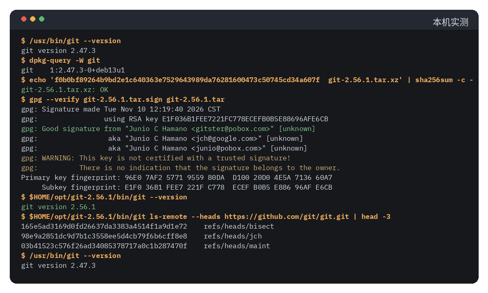

我去，这台 Debian 13 上的 Git 到今天还是 2.47.3。上游 11 月 10 日已经发了 **2.56.1**，专门补 6 个安全问题。

[Git 2.56.1 的发布说明](https://www.kernel.org/pub/software/scm/git/docs/RelNotes/2.56.1.adoc) 写得很短，点名了 6 个 CVE，细节要看同一轮的 2.50.2 到 2.55.1。[GitHub Blog 当天的公告](https://github.blog/open-source/git/git-security-vulnerabilities-announced-7/) 把影响写得更清楚：递归克隆恶意仓库时可能执行代码、路径穿越、处理签名或二进制补丁时的内存损坏，以及 `git fast-import` 可能摸到仓库外面的文件。kernel.org 上这批补丁包的时间戳是 2026-11-10 17:49 UTC，也就是北京时间 11 月 11 日 01:49。

我没去复现这些漏洞，也没在自己的 Mac 或 iPhone 上做过任何操作。下面只对照官方文档，再加上我在这台 Linux 上实跑的编译过程。



<small>示意图，按官方安全公告和版本号整理，不是系统设置截图。</small>

## 我这台机器上的版本，发行版还没跟上

`/usr/bin/git --version` 报的是 **git version 2.47.3**，Debian 包版本是 `1:2.47.3-0+deb13u1`。我 11 月 12 日打开 [CVE-2026-111760 的 Debian 跟踪页](https://security-tracker.debian.org/tracker/CVE-2026-111760)，Trixie、Bookworm、Forky、Sid 都还标着 vulnerable，unstable 写的是 unfixed。同一天的 [源包跟踪页](https://security-tracker.debian.org/tracker/source-package/git) 也列着这 6 个未关闭的问题。

官方补丁版本是 **2.56.1**，以及 2.55.1、2.54.1、2.53.1、2.52.1、2.51.3、2.50.2。[kernel.org 的 Git 下载目录](https://www.kernel.org/pub/software/scm/git/) 里，这几个包都是 11 月 10 日挂上去的。我没有看到 2.47 这条线再发一个小版本。

等发行版包当然也可以。我这边不等了，决定把 2.56.1 编到用户目录里，**不替换** `/usr/bin/git`。

公告里的临时做法是：只从信任的服务器克隆，别对不信任的仓库做递归克隆，别合并不信任的内容或标签，也别处理来路不明的二进制补丁和 fast-import 流。GitHub 那篇写了，这些**不能代替**装补丁。

## 校验官方源码，再编到 $HOME/opt

包和签名都在上面那个 kernel.org 目录里：`git-2.56.1.tar.xz`、对着未压缩 `.tar` 的 `git-2.56.1.tar.sign`，还有 `sha256sums.asc`。

```bash
curl -fL -O https://www.kernel.org/pub/software/scm/git/git-2.56.1.tar.xz
curl -fL -O https://www.kernel.org/pub/software/scm/git/git-2.56.1.tar.sign
echo 'f0b0bf89264b9bd2e1c640363e7529643989da76281600473c50745cd34a607f  git-2.56.1.tar.xz' | sha256sum -c -
unxz -k git-2.56.1.tar.xz
```

SHA256 我是对着官方 `sha256sums.asc` 里那一行核对的，结果是 OK。

开发者签名要先验密钥指纹。主密钥 **96E0 7AF2 5771 9559 80DA D100 20D0 4E5A 7136 60A7**，写在 [kernel.org Web of Trust 的 Junio 页面](https://www.kernel.org/doc/wot/junio.html) 上。我先去 keys.openpgp.org 拉过一次，那个公钥被去掉了 UID，gpg 直接跳过，没导进去。后来改从 Ubuntu 密钥服务器拉，指纹对得上，才 import。这是我踩到的第一个坑。

```bash
gpg --verify git-2.56.1.tar.sign git-2.56.1.tar
```

输出是 Good signature，签名时间是 2026-11-10 12:19:40（Asia/Shanghai），签名子密钥是 E1F0 36B1 FEE7 221F C778 ECEF B0B5 E886 96AF E6CB。同时也有一句警告：这把密钥没有经过信任签名，gpg 不能证明它属于密钥上写的那个人。我只是把指纹跟官方页面核对过，没有再去做 Web of Trust 认证。

编译依赖方面，这台机器上 `apt-get update` 当时过不去，我只好从 deb.debian.org 按 Packages 索引里的 SHA256 把 .deb 拉下来，用 `dpkg -i` 装了 `make`、`zlib1g-dev`、`libexpat1-dev`、`pkg-config`。你自己的 VPS 一般直接：

```bash
sudo apt install make zlib1g-dev libcurl4-openssl-dev libexpat1-dev pkg-config
```

头文件会在系统路径里，下面两个 curl 的坑可以跳过。

`libcurl4-openssl-dev` 会拖一串别的 -dev 包。这台机器上运行时的 libcurl 已经有了（8.14.1-2+deb13u7），我就把对应版本的 -dev 包解到 `$HOME/opt/curl-dev`，只用里面的头文件。第一次直接 `make`，报找不到 `curl/curl.h`——Debian 把它放在 multiarch 路径 `include/x86_64-linux-gnu/curl/` 下面，`curl-config --cflags` 是空的，因为它以为头文件已经在 `/usr/include`。把解出来的 lib 目录加进 `-L` 更离谱：链接器盯上了里面的 `libcurl.a`，接着要 zstd、gssapi 一堆符号。后来我单独建了个目录，只放一条指向系统 `libcurl.so.4` 的 `libcurl.so` 符号链接，链接才过。

```bash
mkdir -p "$HOME/opt/curl-lib"
ln -sfn /usr/lib/x86_64-linux-gnu/libcurl.so.4 "$HOME/opt/curl-lib/libcurl.so"
tar -xf git-2.56.1.tar.xz
cd git-2.56.1
make prefix="$HOME/opt/git-2.56.1" NO_GETTEXT=YesPlease \
  CURL_CFLAGS="-I$HOME/opt/curl-dev/usr/include/x86_64-linux-gnu" \
  CURL_LDFLAGS="-L$HOME/opt/curl-lib -lcurl" -j"$(nproc)" all
make prefix="$HOME/opt/git-2.56.1" NO_GETTEXT=YesPlease \
  CURL_CFLAGS="-I$HOME/opt/curl-dev/usr/include/x86_64-linux-gnu" \
  CURL_LDFLAGS="-L$HOME/opt/curl-lib -lcurl" install
```

`NO_GETTEXT=YesPlease` 是因为我没装 gettext，界面翻译会缺，安全修补不靠这个。如果你用前面那条 `apt install` 把开发包装全了，普通的 `make prefix="$HOME/opt/git-2.56.1" -j"$(nproc)" all && make prefix="$HOME/opt/git-2.56.1" install` 就够。

## 编完之后

`$HOME/opt/git-2.56.1/bin/git --version` 输出 **git version 2.56.1**。系统的 `/usr/bin/git --version` 仍是 2.47.3，没被覆盖。

我用新二进制在临时目录里 `git init`，写了个文件并提交，然后对官方仓库跑了：

```bash
$HOME/opt/git-2.56.1/bin/git ls-remote --heads https://github.com/git/git.git
```

HTTPS 能用，远端分支列表有返回。我没有跑完整的测试套件。



<small>本机实测，终端输出由本机命令重跑后渲染成图。</small>

要用的话，把 `$HOME/opt/git-2.56.1/bin` 放到 `PATH` 前面就行。等 Debian 自己的包跟上了，再决定要不要改回去。
