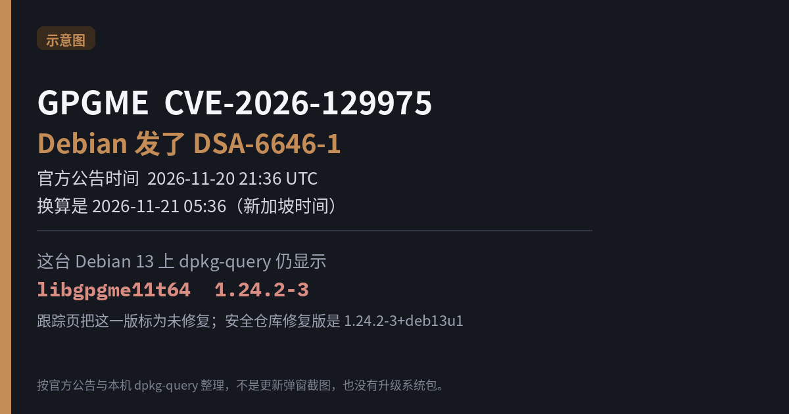
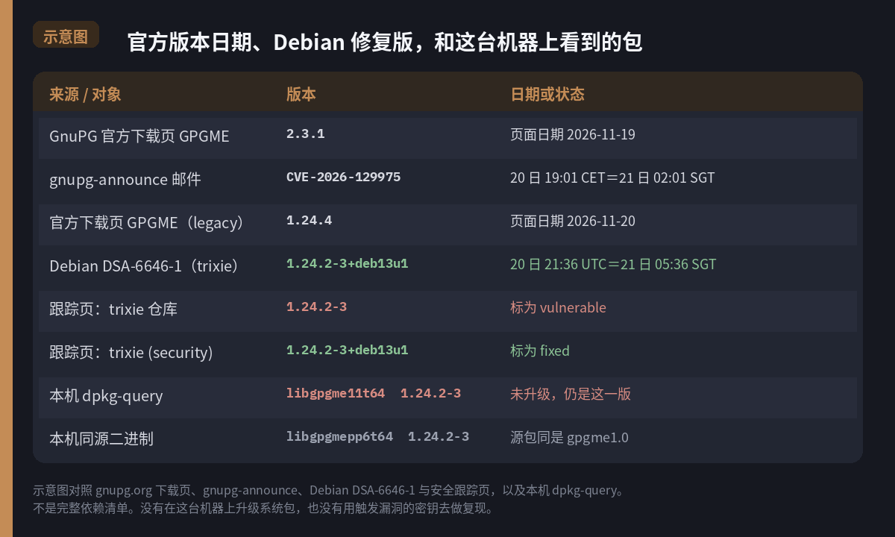

先把两份官方时间换算清楚。GnuPG 的 [gnupg-announce 公告](https://lists.gnupg.org/pipermail/gnupg-announce/2026q4/000517.html) 标的是 Fri Nov 20 19:01:51 CET 2026，换成新加坡时间是 **2026-11-21 02:01**。Debian 的 [DSA-6646-1](https://www.debian.org/security/2026/dsa-6646-1) 邮件头是 Fri, 20 Nov 2026 21:36:59 +0000，换成新加坡时间是 **2026-11-21 05:36**。公告正文里的日期仍写成 November 20, 2026。

这不是 GnuPG 主程序自己的更新。这台机器上 `gpg --version` 看到的是 **2.4.7**，包名是 `gpg` / `gnupg`。今天这条说的是应用程序用来调用 GnuPG 的库：**GPGME**。

我没有升级系统包，也没有拿带超长 user id 的密钥去做复现。下面只对照官方页面，再加一条本机 `dpkg-query` 的结果。



<small>示意图，按官方公告与本机 dpkg-query 整理，不是更新弹窗截图。</small>

## 上游写了什么

[官方下载页](https://gnupg.org/download/) 此刻把 **GPGME 2.3.1** 的日期写成 **2026-11-19**，旁边还有一档 **GPGME (legacy) 1.24.4**，日期是 **2026-11-20**。公告里也写：2.3.1 的 noteworthy changes 日期是 2026-11-19，并注明 **2.3.0 从未对公众发布**。

漏洞编号是 **CVE-2026-129975**，内部工单 [T8557](https://static.dev.gnupg.org/T8557)。公告的说法是：用一把带有「精心构造的非常长的 user id」的 OpenPGP 密钥，可能触发 double free；这种 double free 可被用来从应用程序里带出数据，举例是发送签名数据。至于能不能做到远程代码执行，原文写 can't be ruled out，建议马上更新。

它把受影响范围写成：所有使用 **2.3.0 之前** GPGME 的软件，不论共享库、DLL 还是静态链接。举例名单包括 Gpg4win、GnuPG Desktop、GnuPG VS-Desktop、大多数邮件客户端、不少 XMPP 客户端、Samba，以及他们写成 Flatpack 的那一项。这是公告上的名单，不是我这台机器上的软件列表。同一封邮件还提到新发布了 **Gpg4win 5.1.2**。公告另外写了一句：不必更新 GPGMEPP 或 GPGMEQT。

发现者写成 Johan Carlsson，由 GitLab 在 2026-11-12 告知。原先约定 2026-11-25 协调披露；公告说因为 Ruby2Shell，GitLab 需要提前更新，所以 GPGME 也在 2026-11-20 披露。

## Debian 的修复版不是 2.3.1

Debian 没把 stable 直接拉到 2.3.1。DSA-6646-1 写的是：Johan Carlsson 发现 GPGME 没有正确处理带有精心构造的超长 user id 的 OpenPGP 密钥，可能导致信息泄露、拒绝服务，以及潜在的任意代码执行。stable（trixie）的修复版本是 **1.24.2-3+deb13u1**，并建议升级 `gpgme1.0` 包。

[Debian 安全跟踪页](https://security-tracker.debian.org/tracker/CVE-2026-129975) 今天看到的状态是：trixie 仓库里的 **1.24.2-3** 标成 vulnerable，trixie (security) 里的 **1.24.2-3+deb13u1** 标成 fixed。bookworm 走的是另一条 DLA-4924-1，修复版写成 1.18.0-3+deb12u1。sid 已经有 2.3.1-1。这些都是跟踪页上的表格，我没有去改这台机器的软件源。

## 这台机器上实际看到的版本

我在这台 Debian 13 上跑的是：

```
dpkg-query -W -f='${Package}\t${Source}\t${Version}\n' libgpgme11t64 libgpgmepp6t64
```

输出是：

```
libgpgme11t64	gpgme1.0	1.24.2-3
libgpgmepp6t64	gpgme1.0	1.24.2-3
```

两个二进制都来自源包 `gpgme1.0`，版本都还是跟踪页标成未修复的那一档。`apt-cache rdepends --installed libgpgme11t64` 在这台机器上只列出已经安装的 `libgpgmepp6t64`。没有据此去判断别的机器上有没有邮件客户端在用它。

系统里的 `gpg` 仍是 2.4.7-21+deb13u1+b5，不要和这条 GPGME 更新混在一起。



<small>示意图，对照上述官方页面与本机查询整理；不是完整依赖清单，也不是我升级后的结果。</small>

我没有执行 `apt upgrade` 或 `apt install`，也没有把上游 tarball 解到用户目录里替换系统库。这篇不是安装步骤。官方建议升级的话，请直接看 [DSA-6646-1](https://www.debian.org/security/2026/dsa-6646-1) 和发行版自己的安全更新说明。

我的理解（推断）：已经在跑 Debian 13 的人，真正要对上的修复版本号是 **1.24.2-3+deb13u1**，不是下载页上那条最新的 2.3.1。这台机器现在还停在 1.24.2-3，跟踪页把它标成未修复；我这边今晚没有动系统包，也不把这篇当成「已经打过补丁」的证明。
