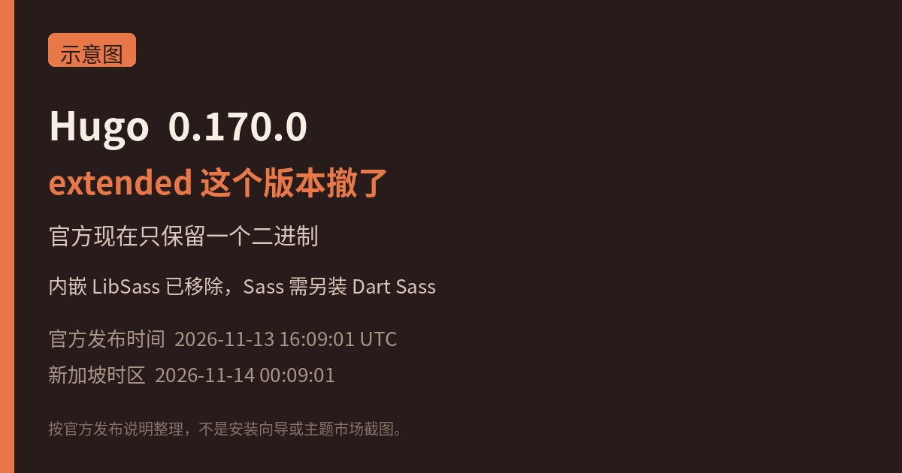
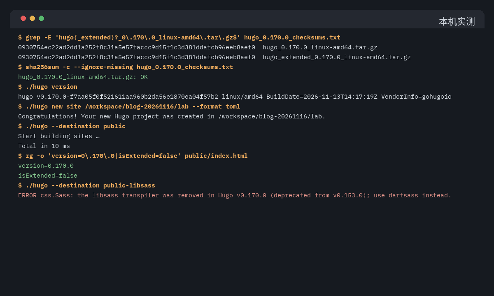

[Hugo 官方新闻页](https://gohugo.io/news/) 把 **v0.170.0** 写在 2026-11-13 这一档。[新闻 RSS](https://gohugo.io/news/index.xml) 和 [GitHub 发布页](https://github.com/gohugoio/hugo/releases/tag/v0.170.0) 的时间都是 2026-11-13 16:09:01 UTC，换到新加坡时区（UTC+8）是 **2026-11-14 00:09:01**。发布说明里最大的变化就一句：extended 这个版本没了，内嵌的 LibSass 也一起拿掉，现在只剩一个官方二进制。

我日常写这个博客用的是 Hexo，没有把站点迁到 Hugo，也没有往系统路径里装这个版本。下面这些步骤都发生在临时目录里，用来核对官方说明是不是像写的那样。

<small>示意图，按官方发布说明整理，不是安装向导或主题市场截图。</small>

## 官方包现在怎么区分

发布说明写得很直接：LibSass 废弃已久，它曾是必须做 CGO 版 extended 构建的主要原因；去掉之后，**除了 LibSass，原先 extended 里的功能都在这一个二进制里**。文档还说：`css.Sass` 再把 `transpiler` 设成 `libsass` 会报错，Dart Sass 成为默认也是唯一的转译器，用 Sass 需要[另外安装 Dart Sass](https://gohugo.io/functions/css/sass/)。`hugo.IsExtended` 现在**永远返回 false**，模块配置里的 `hugoVersion.extended` 已弃用且不再生效。

为了减少 CI 突然断掉，官方暂时还为几个下载量高的包名提供别名，例如 `hugo_extended_0.170.0_linux-amd64.tar.gz`，但建议脚本改用标准包名。`extended_withdeploy` 构建也去掉了。

我把 [官方 checksums](https://github.com/gohugoio/hugo/releases/download/v0.170.0/hugo_0.170.0_checksums.txt) 和标准包 `hugo_0.170.0_linux-amd64.tar.gz` 下到临时目录。清单里这两行的 SHA256 **完全一样**：

`0930754ec22ad2dd1a252f8c31a5e57faccc9d15f1c3d381ddafcb96eeb8aef0  hugo_0.170.0_linux-amd64.tar.gz`

`0930754ec22ad2dd1a252f8c31a5e57faccc9d15f1c3d381ddafcb96eeb8aef0  hugo_extended_0.170.0_linux-amd64.tar.gz`

我用 `sha256sum -c --ignore-missing` 核对下载到的标准包，结果是 **OK**。这和发布说明里「别名」的说法对得上。我没有再去验发行签名。

## 临时目录里跑了一个最小站点

二进制解到临时目录后，`./hugo version` 打出来的是：

`hugo v0.170.0-f7aa05f0f521611aa960b2da56e1870ea04f57b2 linux/amd64 BuildDate=2026-11-13T14:17:19Z VendorInfo=gohugoio`

构建时间比 GitHub 发布时间略早，都是 11 月 13 日。接着 `hugo new site` 建了一个新项目，自己写了一个最简的 `layouts/index.html`，没有装主题。生成出来的首页里，`hugo.Version` 是 **0.170.0**，`hugo.IsExtended` 是 **false**。构建时有一条警告：taxonomy 这种 kind 还没有对应的布局文件。首页本身写出来了，我没再补那些模板。

然后专门去踩发布说明里的那处变更。在模板里把 `css.Sass` 的 `transpiler` 设成 `libsass`，构建退出码是 1，报错原文是：

`css.Sass: the libsass transpiler was removed in Hugo v0.170.0 (deprecated from v0.153.0); use dartsass instead.`

并指向官方文档 [css.Sass](https://gohugo.io/functions/css/sass/)。这和文档里 “New in v0.170.0” 那句一致。

这台机器的 `PATH` 上没有 `sass` 或 `dart-sass`。我再试了一次默认的 `css.Sass`（不指定 transpiler），同样失败，前半段要求安装 Dart Sass，仍然指向同一篇文档；后半段还跟了一句 `this feature is not available in your current Hugo version` 和一个短链接。我按屏幕原文记下，不把它解释成「这个官方包少了功能」——发布说明写的是：现在只有一个二进制，Sass 要另装 Dart Sass。这次实验里我没有再去装 Dart Sass。

<small>本机实测，命令和输出均来自这次在临时目录里的运行；不是合成截图。</small>

发布说明里另外还有几处，我没有逐项复现，只把官方原文的要点记在这里：命令行参数现在会覆盖同名的操作系统环境变量；passthrough 内容在没有对应 render hook 时会做 HTML 转义，除非打开了 `markup.goldmark.renderer.unsafe`；`wrapperClass` 会被转义；vendored 模块路径被限制在 `_vendor` 目录。这版二进制是用 **Go 1.27.4** 编的，发布说明写它带了 12 个安全修复，其中跟 `hugo server` 更直接相关的是 `net/http` HTTP/1 服务器的一处崩溃。我没有启动 `hugo server`，也没有拿这些条目去做复现。

我的理解（推断）：如果你的 CI 还在写 `hugo_extended_*`，可以先核对校验和是不是已经变成同一个文件，再按官方建议改成标准包名。真正用到 Sass 的项目，现在要单独准备 Dart Sass，不能再指望内嵌 LibSass。至于要不要把现有站点升到 0.170.0，得看你自己的主题和构建脚本，这篇只是临时目录里的核对，不是迁移指南。
