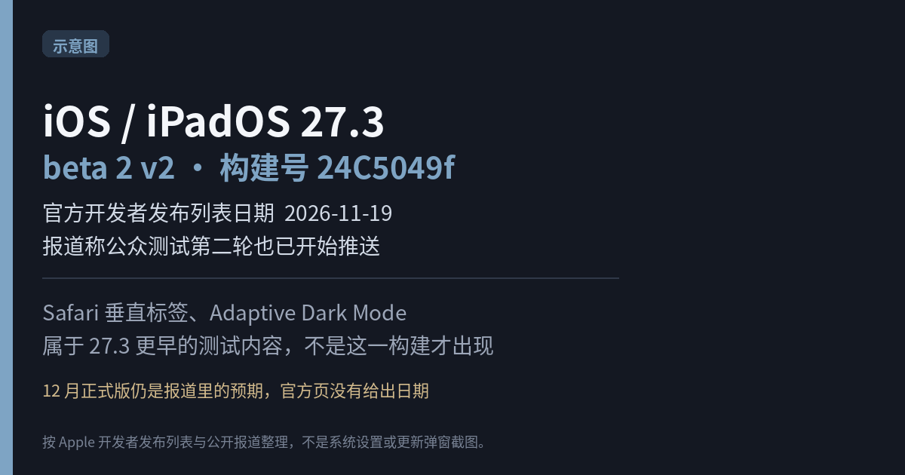
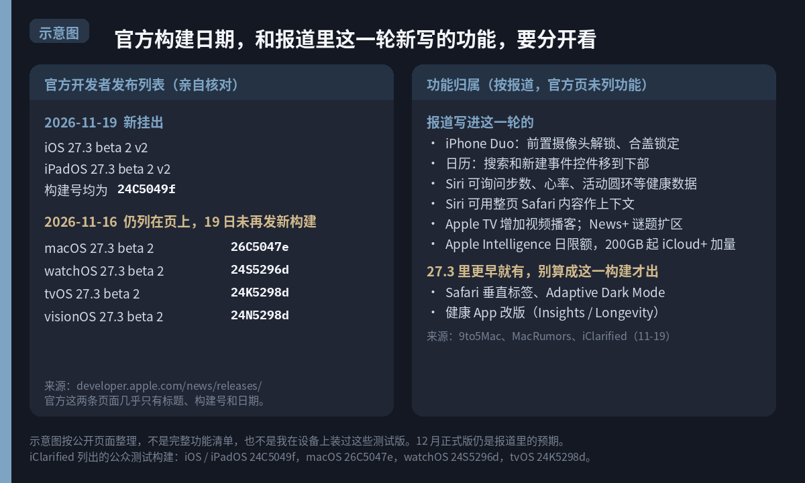

今天再打开 [Apple 开发者发布列表](https://developer.apple.com/news/releases/)，最上面两条还是昨天挂上去的：**iOS 27.3 beta 2 v2**，还有一条 **iPadOS 27.3 beta 2 v2**。构建号都是 **24C5049f**，日期写着 **November 19, 2026**。点进 [iOS 那条](https://developer.apple.com/news/releases/?id=11192026a) 和 [iPadOS 那条](https://developer.apple.com/news/releases/?id=11192026b) 看，页上几乎就这三样：标题、构建号、日期。功能说明没有。

我自己的 iPhone 和 iPad 都没装这些测试版。下面只对照官方页面，再加几篇 19 日发出的报道。

<small>示意图，按 [Apple 开发者发布列表](https://developer.apple.com/news/releases/) 与公开报道整理，不是系统设置或更新弹窗截图。</small>

## 官方页昨天新挂的，和 16 日那批要分开看

11 月 19 日的列表上，新出来的开发者构建其实就这两个，都是 beta 2 v2。同一页再往下翻，还能看到 16 日那一组，构建号没动：

- macOS 27.3 beta 2：**26C5047e**
- watchOS 27.3 beta 2：**24S5296d**
- tvOS 27.3 beta 2：**24K5298d**
- visionOS 27.3 beta 2：**24N5298d**

Xcode 27.3 beta 2 也是 16 日那条。它们的日期仍写 November 16, 2026，19 日的列表里没有再给这些系统发新构建。iOS / iPadOS 更早的 beta 2 构建号是 **24C5049d**，同样挂在 16 日，昨天才换成 24C5049f。

## 公众测试第二轮：报道写了，官方 Releases 页没单独列

公众测试第二轮，我在这份 Releases 页上没找到单独条目，是报道在写。

[9to5Mac](https://9to5mac.com/2026/11/19/apple-releases-ios-27-3-public-beta-2-heres-whats-new/) 那篇标注 Nov 19 2026，1:37 pm PT，换成新加坡时间是 **2026-11-20 05:37**。它说 iOS 27.3 的公众测试第二轮已经放出，开发者那边同时换了 beta 2 的新构建。同一家还另写了一篇 [iPadOS、watchOS 这些平台的说明](https://9to5mac.com/2026/11/19/ipados-27-3-watchos-27-3-more-get-public-beta-2-heres-whats-new/)，时间是 1:42 pm PT。

[MacRumors](https://www.macrumors.com/2026/11/19/ios-27-3-public-beta-2/) 标的是同一天 1:43 pm PST，换算是 05:43。它写 Apple 把 iOS、iPadOS、macOS Golden Gate、tvOS、watchOS 的 27.3 第二轮测试版推给了公众测试计划，开发者则拿到修订后的 iOS / iPadOS 构建。

[iClarified](https://www.iclarified.com/103695/apple-releases-second-public-betas-of-ios-273-macos-273-and-more) 把当前公众测试构建写成：iOS / iPadOS 27.3 为 **24C5049f**，macOS 27.3 为 **26C5047e**，watchOS 27.3 为 **24S5296d**，tvOS 27.3 为 **24K5298d**。后三个跟官方 16 日的开发者构建号对得上；iPhone 和 iPad 对上的是昨天新换的 24C5049f。visionOS 有没有进公众测试，这几篇没写清楚，我不猜。

要参加的话，报道指向免费的 [Apple Beta Software Program](https://beta.apple.com/)。已经报过名的，9to5Mac 和 iClarified 都写了 iPhone / iPad 走「设置 → 通用 → 软件更新 → Beta 更新」，Mac 在系统设置里有对应入口。这些步骤我没在自己机器上走过，这篇也不当安装教程写。测试版往往不能随便降级，要装先备份——这句报道里有，常识也是这个。

## 这一轮报道新写的，和 27.3 里早就有的别混

官方那两页没有功能清单，功能都是报道在列。有些是这一轮新写进去的，有些是 27.3 周期里更早就有的，别混在一起。

9to5Mac 把下面这些当成这一轮值得先看的变化，iClarified 也写到了其中几条。MacRumors 则把 Duo 的面部解锁和合盖锁定，写成第二轮开发者测试里才引入：

- **iPhone Duo**：可以用封面外侧的前置摄像头解锁，但只在折叠状态下可用；支付、密码和应用验证仍要 Touch ID 或密码。45 分钟没解锁的话，也还得再用一次。另外有一个合上就锁定的选项。Duo 还有 Attention Aware：看着外屏时可以保持点亮，并压低部分提示音，不必先开面部解锁。
- **日历**：搜索和新建事件的控件移到了下部。
- **Siri**：可以询问健康数据，报道举了步数、心率和活动圆环。它也可以把一整页 Safari 内容当作上下文，包括还没滚到的部分。
- **Apple TV** 增加视频播客，以及 Apple Originals 的竖向片段信息流。**Apple News+** 的谜题扩展到澳大利亚、加拿大法语区和英国，具体题库按地区不同。
- 高级 Apple Intelligence / Siri 功能开始测试每日用量上限；报道写 200GB 及以上的 iCloud+ 方案会加量，50GB 方案维持标准限额。

Safari 的**垂直标签**和 **Adaptive Dark Mode**，别当成这一构建才出的东西。9to5Mac 把它们放在「More iOS 27.3 features」里，还写第一轮公众测试是 11 月 5 日；iClarified 也说这两项是第一轮就引入的。改版后的健康 App（Insights、Longevity / Health Age）也在这组，9to5Mac 说是第一轮公众测试里、在 27.2 预览之后重新出现的。Duo 的 Reachability，还有待机显示里更多的表盘选项，一并算在「更早就有」。

<small>示意图，对照上述官方页面与报道整理；不是完整功能清单，也不是我实测。</small>

## 12 月正式版，官方页还没有日期

MacRumors 写：We're expecting all of Apple's updates to launch in December。9to5Mac 那篇平台说明写的是 mid-December。这是报道里的预期，不是 Apple 官方 Releases 页给出的日期。我按原样记下，不把它写成已经排定的上市日。

我的理解（推断）：已经在测公众测试的人，昨天官方列表上真正换新的，是 iOS / iPadOS 构建号到了 24C5049f。要是冲着 Safari 垂直标签去的，那是 27.3 这轮更早就在测的，不必理解成昨天刚有。这仍是测试版。我没装，也不拿这篇当日常机升级建议。
