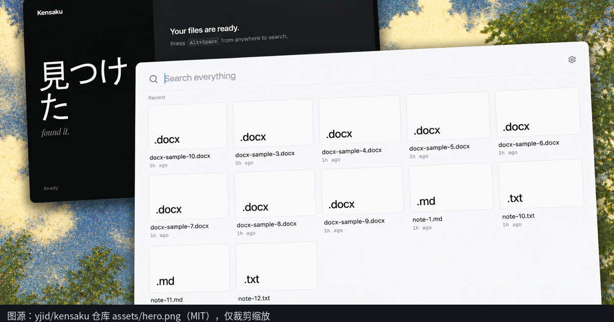
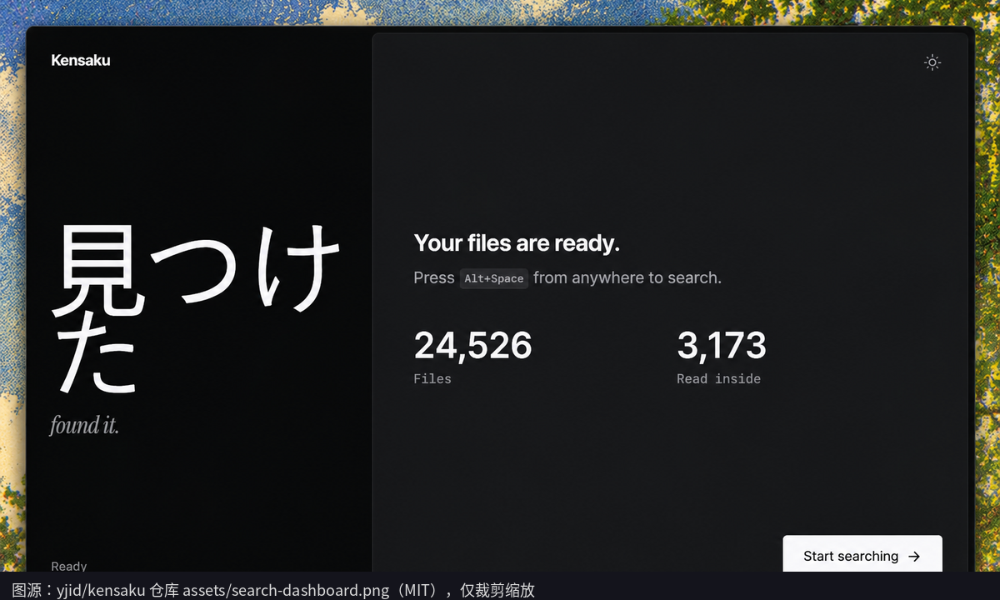

文件名想不起来、PDF 存成 `notes-final-2.pdf`、报错只活在一张截图里——这种事我太熟了。今天翻到的 [yjid/kensaku](https://github.com/yjid/kensaku) 走的就是这条：在你自己的电脑上搜文件名，也搜文件里面的字。

先说清楚：我没下载、没安装、也没实际搜过，下面只整理官方 README、[CHANGELOG](https://github.com/yjid/kensaku/blob/master/CHANGELOG.md) 和 [1.0.17 发布说明](https://github.com/yjid/kensaku/releases/tag/v1.0.17)。

<small>图：[yjid/kensaku 仓库 assets/hero.png](https://github.com/yjid/kensaku/blob/master/assets/hero.png)，MIT 许可，只裁剪缩放并加了来源条。</small>

## 它是个啥

仓库 2026-10-24 建的（UTC），[MIT 许可](https://github.com/yjid/kensaku/blob/master/LICENSE)。我写这篇时 GitHub 显示大约 1500 多 star。Windows、macOS、Linux 都有包，macOS 是 Intel 和 Apple 芯片共用的 `kensaku_<version>_universal.dmg`。界面支持英语、简体中文和俄语，可按系统语言自动切。

能搜的范围，README 写得很具体：PDF、DOCX、PPTX、XLSX、EPUB、ODT/ODS/ODP、RTF、CSV，还有 `.eml` / `.msg` 邮件，以及五十多种代码和数据格式。截图、照片走 OCR：默认 PP-OCRv6，模型包大约 6.1 MB，第一次会下载；设置里还能换成更大的 Indra，或用 Tesseract。中日韩文本是默认就做了分词的，细节在 [docs/LANGUAGES.md](https://github.com/yjid/kensaku/blob/master/docs/LANGUAGES.md)。

启动方式有两种：托盘里一键呼出，或普通桌面窗口。第一次要自己勾要索引的文件夹，搜的同时还能继续扫盘。

最新稳定版是 **1.0.17**，GitHub 发布时间 2026-11-09 18:48 UTC，换算成本地（Asia/Shanghai）是 **2026-11-10 02:48**。发布说明把它标成安全更新：收紧了 MCP 代理的读取范围、更新包的落地检查，以及 Office 文档解析的内存预算。想用的话，跟着最新版走就行。

<small>图：[yjid/kensaku 仓库 assets/search-dashboard.png](https://github.com/yjid/kensaku/blob/master/assets/search-dashboard.png)，MIT 许可，只裁剪缩放。</small>

## 官方说有多快，以及他们自己划的边界

速度数字全部出自 README 的 [Performance](https://github.com/yjid/kensaku#performance) 和 [docs/BENCHMARKS.md](https://github.com/yjid/kensaku/blob/master/docs/BENCHMARKS.md)，不是我测的：

- 10 万条文件名，Windows 11、1.0.16、默认线程：平均 **18 ms**（最好 8.3 ms）。
- 同一工作量、4 线程：平均 **3.1 ms**。
- Linux 上暖缓存参考：平均 **1.3 ms**。
- 10 万条文件的元数据大约 **12.2 MB**。

他们写得很老实：Windows 和 Linux 不是同一台机器，不能拿来比谁更快；Spotlight、Everything、Listary **没有被放进这组测试**；这组数字也不是 macOS 上的结果。所以 Mac 上手会有多快，README 没给答案。

隐私这块也是官方自己写的：不注册、无遥测、不做云端搜索；查询和文件内容默认不出本机。但不是完全断网——[Privacy and security](https://github.com/yjid/kensaku#privacy-and-security) 写明，出站请求只用于检查更新，以及下载模型 / OCR 包。索引里会留下文件名和抽出来的正文，官方提醒别把它同步到共享位置。

还有两个坑，README 的 Status 里写着：安装包 **还没代码签名**，macOS 和 Windows 第一次打开会警告，这是预期现象；Windows 实测更多，macOS 和 Linux 包是 CI 编出来的，官方自己在向这两边要更多反馈。

## 想试的话

去 [Releases](https://github.com/yjid/kensaku/releases/latest) 下对应系统的包，同目录有 `SHA256SUMS`。macOS 遇到拦截，按 [docs/INSTALL.md](https://github.com/yjid/kensaku/blob/master/docs/INSTALL.md) 到系统设置 → 隐私与安全性里选「仍要打开」。

我的理解（推断）：如果你经常在一堆 PDF、会议纪要和截图里找一句话，这个方向是对症的。至于是不是已经能换掉 Spotlight，我没跑过，不敢说。官方自己都把 Mac 测试写得比较保守，先当「能用、要自己留意签名警告」来看，比较稳。
