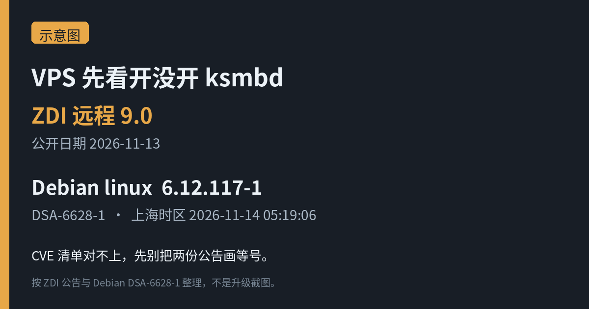
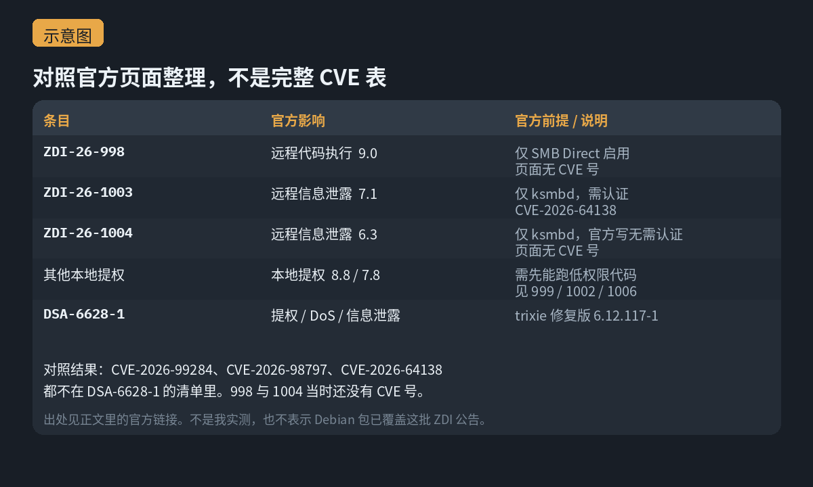

Zero Day Initiative 在 2026-11-13 公开了一批 Linux 内核公告，完整名单在它的[已发布公告列表](https://www.zerodayinitiative.com/advisories/published/)里。最扎眼的是 [ZDI-26-998](https://www.zerodayinitiative.com/advisories/ZDI-26-998/)：官方标题写成 KSMBD 的 SMB Direct 整数下溢，影响是远程代码执行，CVSS 9.0。页面上还有两句限制写得很硬——**只有启用了 SMB Direct 的系统才受影响**；认证要不要，取决于配置。我查这篇的时候，页面上还没有 CVE 编号。

同一天还有两条也点名了 ksmbd：

- [ZDI-26-1003](https://www.zerodayinitiative.com/advisories/ZDI-26-1003/)（CVE-2026-64138）：远程信息泄露，CVSS 7.1。官方写需要认证，而且只有启用了 ksmbd 的系统才受影响。
- [ZDI-26-1004](https://www.zerodayinitiative.com/advisories/ZDI-26-1004/)：远程信息泄露，CVSS 6.3。页面上没有 CVE 编号；官方写不需要认证，同样只有启用了 ksmbd 的系统才受影响。

其余几条是本地提权，官方前提都是攻击者得先能在目标上跑低权限代码。比如 [ZDI-26-999](https://www.zerodayinitiative.com/advisories/ZDI-26-999/)（CVSS 8.8，页面无 CVE 号）、[ZDI-26-1002](https://www.zerodayinitiative.com/advisories/ZDI-26-1002/)（CVE-2026-98797，CVSS 8.8）、[ZDI-26-1006](https://www.zerodayinitiative.com/advisories/ZDI-26-1006/)（CVE-2026-99284，CVSS 7.8）。完整名单还是以 ZDI 那张表为准。我没有复现任何一条，下面只按官方 Impact 转述。

各条公告都写了 Linux 已经发布修复，并链到了 [torvalds/linux](https://github.com/torvalds/linux) 上对应的提交。发行版什么时候打进自己的内核包，要看各家自己的公告，不要默认「上游修了等于你的 VPS 已经打上」。

<small>示意图，按 ZDI 公告与 Debian DSA-6628-1 整理，不是内核日志或我升级时的截图。</small>

## Debian 今天凌晨也发了内核更新，但清单对不上

另一件事落在同一天的日历上，时区换一下就到了今天凌晨。[Debian 安全公告 DSA-6628-1](https://www.debian.org/security/2026/dsa-6628) 的邮件日期是 2026-11-13 21:19:06 UTC，换到上海时区是 **2026-11-14 05:19:06**。官方原文是：Linux 内核里发现了若干漏洞，可能导致提权、拒绝服务或信息泄露。稳定版（trixie）的修复版本是 **6.12.117-1**，建议升级 linux 软件包。

[跟踪页 DSA-6628-1](https://security-tracker.debian.org/tracker/DSA-6628-1) 把 trixie 普通档的 6.12.107-1 标成 vulnerable，把 trixie（security）的 6.12.117-1 标成 fixed。

我把 DSA 正文里的 CVE 清单，和上面几条已经有编号的 ZDI 条目对了一下：**CVE-2026-99284、CVE-2026-98797、CVE-2026-64138 都不在 DSA-6628-1 的清单里**。ZDI-26-998 和 ZDI-26-1004 当时页面上还没有 CVE 号，也就无从对号。所以我不会把「Debian 这个包」说成「已经覆盖了这批 ZDI 公告」。这是对照清单之后的判断，不是 Debian 或 ZDI 自己的声明。

<small>示意图，对照上述官方页面整理；不是完整 CVE 表，也不是我实测。</small>

## 该看什么，以及我没在这台机器上做什么

如果你在跑 Debian 13 的官方内核包，DSA 的建议很直接：把 linux 软件包升到 6.12.117-1。内核更新之后通常要重启，新内核才会接手。这是公告里的升级建议，加上内核更新的常规做法，不是我在某台 VPS 上走完的步骤。

如果你的机器开了 ksmbd，或者开了 SMB Direct，除了跟发行版内核进度，也可以先回到 ZDI 各自页面上的那句前提：998 写的是只有 SMB Direct 启用才受影响，1003 和 1004 写的是只有 ksmbd 启用才受影响。不需要这个内核 SMB 服务的，就不要加载它。我没有在生产环境里关过谁的服务，也不把这句话当成已经替你验证过的缓解手册。

这台用来写稿的 Debian 13 机器，`uname -r` 是 6.12.113+，`modinfo ksmbd` 没有模块信息。版本号带 `+`，我不把它当成 Debian 软件源里的官方内核包来报，这里也没有安装 6.12.117-1，更没有拿它复现任何问题。

我的理解（推断）：今天更值得分开做的是两件事——Debian 稳定版用户按 DSA-6628-1 把官方内核包升上去；开了 ksmbd 或 SMB Direct 的人，再单独盯发行版后续有没有写到这批 ZDI 编号。两份公告同一天出现，并不等于已经互相覆盖。
