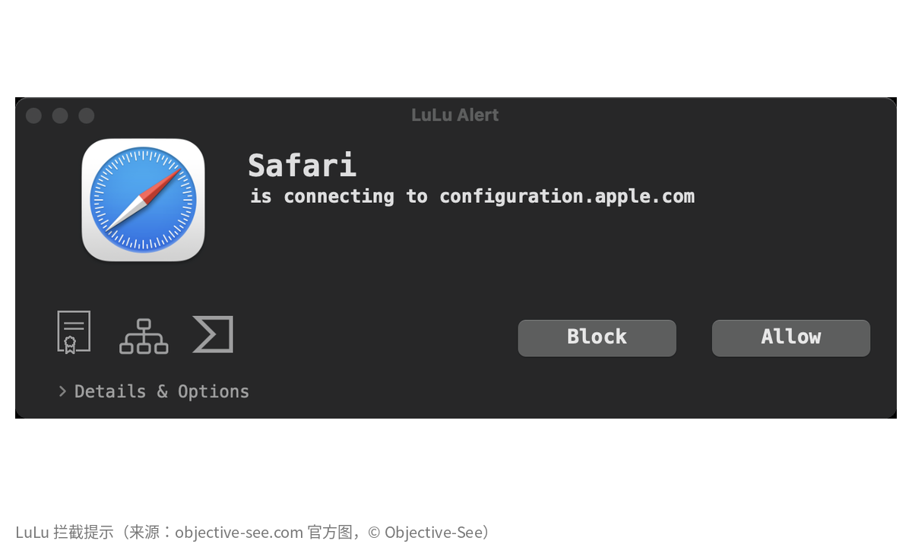
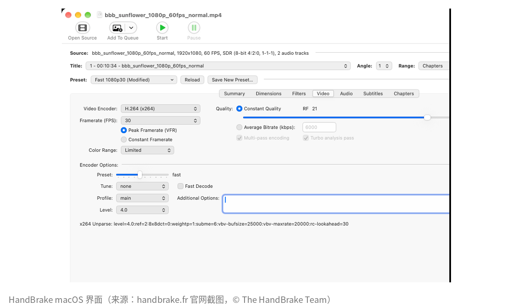

这期就两个，第三个没凑出来，那就不凑了。

丑话说前头：两个我都没在自己 Mac 上装过，下面每句话都是从官网、仓库、release 说明里抄来的，点链接就能对。"作者没付费产品"这条，我只翻了官网产品页（11 月 7 日），翻不到不代表一定没有。

##  LuLu：盯住往外连的程序

Mac 自带那个防火墙，只管**别人连进来**。往外连的它不管——[LuLu](https://objective-see.org/products/lulu.html) 补的就是这块：哪个没见过的程序想往外连，先弹窗问你。可以只拦某个地址，也可以让规则过几个小时自己失效。

Objective-See 是个[非营利基金会](https://objective-see.org/about.html)，[工具页](https://objective-see.org/tools.html)上那一排安全小工具全标着 free、open-source，靠 Patreon 和 GitHub Sponsors 过日子。代码在 [objective-see/LuLu](https://github.com/objective-see/LuLu)，[GPL-3.0](https://github.com/objective-see/LuLu/blob/master/LICENSE.md)。

11 月 2 日晚上刚出 [v4.5.7](https://github.com/objective-see/LuLu/releases/tag/v4.5.7)。说明里有条挺贴心：launchd 每小时跑一次的脚本，以前跑一次弹一次，烦死人；现在只弹一回，后面的连接先排队等你点。



<small>图：[objective-see.com 官方图](https://objective-see.com/images/LL/alert.png)，© Objective-See。官网没写许可，我只缩放、加了白边。</small>

[官方文档](https://objective-see.org/products/lulu.html)里自己承认的毛病：Chrome 这类不走 Network.framework / NSURLSession 的浏览器，**按域名拦不了，只能按 IP**；Safari、Firefox 没这问题。还有些流量压根不走网络扩展，LuLu 看都看不到。装的时候得去系统设置批系统扩展和网络过滤器，来回点好几下。

##  HandBrake：视频转码的老面孔

鸡尾酒配菠萝，这图标不用介绍了吧。[HandBrake](https://handbrake.fr/) 把几乎任何格式的视频转成 H.264、H.265 这类常用编码，懒人点预设，较真的人有一整页参数可以抠。

一群志愿者在做，[官网](https://handbrake.fr/)首页就一句"It's free!"，翻遍也没见付费版。代码在 [HandBrake/HandBrake](https://github.com/HandBrake/HandBrake)，[LICENSE](https://github.com/HandBrake/HandBrake/blob/master/LICENSE) 说大部分文件 GPLv2。稳定版还是 6 月的 [1.11.2](https://github.com/HandBrake/HandBrake/releases/tag/1.11.2)，[下载页](https://handbrake.fr/downloads.php)写 macOS 10.13 就能跑——我去，2017 年的系统都还认，门槛低得有点感人。



<small>图：[handbrake.fr 首页轮播图](https://handbrake.fr/img/slides/slide1_mac.png)，© The HandBrake Team。同样没写许可，只缩放加白边。</small>

下载就去 handbrake.fr 或 GitHub release。搜索结果里那些"HandBrake 中文绿色版"，别点。


## 懒得点 dmg

```sh
brew install --cask lulu handbrake-app
```

cask 页面在这：[lulu](https://formulae.brew.sh/cask/lulu)、[handbrake-app](https://formulae.brew.sh/cask/handbrake-app)。注意 HandBrake 那个叫 handbrake-app，我一开始查 handbrake，直接 404，离谱。

<small>封面是两个官方图标摆在一起，图标只缩放没改。LuLu 图标出自 [objective-see/LuLu](https://github.com/objective-see/LuLu) 仓库（GPL-3.0），© Objective-See；HandBrake 图标出自 [handbrake.fr](https://handbrake.fr/img/logo.png)，© The HandBrake Team，官网没写许可。</small>
