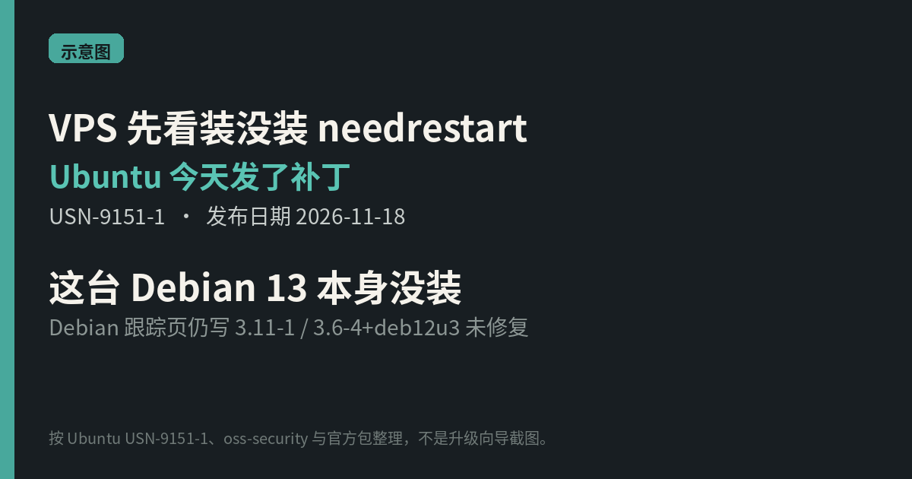
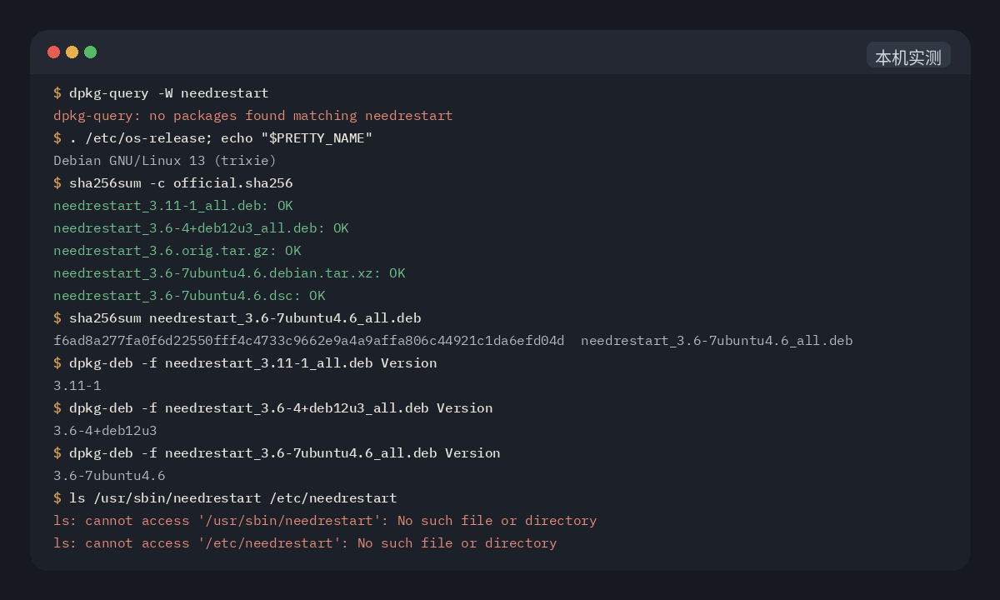

Ubuntu 今天挂出了安全公告 [USN-9151-1](https://ubuntu.com/security/notices/USN-9151-1)，标题是 needrestart vulnerability，发布日期写的是 **2026-11-18**。对应编号是 [CVE-2026-124757](https://ubuntu.com/security/CVE-2026-124757)。Ubuntu 这条 CVE 页的公布日期是 11 月 17 日，最后更新是 11 月 18 日。

公开说明更早出现在 [oss-security](https://www.openwall.com/lists/oss-security/2026/11/17/27)。Armaan Sandhu 那封邮件的时间是 2026-11-17 15:45:00 -0500，换到新加坡时区（UTC+8）是 **2026-11-18 04:45:00**。信里写，跟发行版约定的公开时间是 11 月 17 日 21:30 CET，也就是新加坡时区 11 月 18 日 04:30。上游 [needrestart 3.11.1](https://github.com/liske/needrestart/releases/tag/v3.11.1) 的 GitHub 发布时间是 2026-11-17 23:20:33 UTC，换到新加坡时区是 **2026-11-18 07:20:33**。

这台机器是 Debian GNU/Linux 13 (trixie)。我先跑了 `dpkg-query -W needrestart`，输出是：`dpkg-query: no packages found matching needrestart`。`/usr/sbin/needrestart` 和 `/etc/needrestart` 都不在。所以后面没有在这台机器上升级或改配置，只把官方包下到临时目录，核对校验和，再拆开看 Debian 现有包和 Ubuntu 补丁包差在哪里。我没有去复现这个漏洞。



<small>示意图，按 Ubuntu USN-9151-1、oss-security 与官方包版本整理，不是升级向导或桌面弹窗截图。</small>

## 公告里怎么写

[USN-9151-1](https://ubuntu.com/security/notices/USN-9151-1) 的概述是：needrestart could be made to run programs as an administrator。细节写 Armaan Sandhu 发现它没有正确处理 systemd 的 cgroup 路径和进程名，本地攻击者有可能据此提权。

Ubuntu 的 [CVE 页](https://ubuntu.com/security/CVE-2026-124757) 还补了一句：它没有正确校验进程名和 cgroup 路径，本地攻击者可能提权到 root，或注入任意输出。页面把优先级标成 high，给出的理由是 Local privilege escalation。

oss-security 那封信里，作者确认受影响的是 Debian bookworm 的 **3.6-4+deb12u3**，以及 Ubuntu 24.04 的 **3.6-7ubuntu4.5**。Debian trixie 的 **3.11-1** 被写成部分受影响：本地用户仍可能让 needrestart 把自己的进程当成 root 的 session，随后打包的 notify hook 会以 root 去跑 notify-send，并带上对方选定的 DISPLAY 和文本；信里写，命令执行在 trixie 上没有复现。作者也写了，这套 hook 不只在 apt 之后才会跑，从自动化或监控里直接调用 needrestart 同样可能碰到。触发条件他测过的是 root 执行 apt-get，且系统还装着默认的 apt hook；unattended-upgrades 他没有测。

这些细节我只按原文转述，没有自己去搭环境验证。下文也不写复现步骤。

Ubuntu 列的修复版本是：24.04 LTS 为 **3.6-7ubuntu4.6**，22.04 LTS 为 **3.5-5ubuntu2.6**，26.04 LTS 为 **3.11-1ubuntu2.26.04.1**，26.10 为 **3.11-1ubuntu2.26.10.1**。20.04、18.04、16.04 的修复包写在 Ubuntu Pro / ESM 里，我没有去下那些包。

[Debian 安全跟踪页](https://security-tracker.debian.org/tracker/CVE-2026-124757) 在我核对的时候，仍把 bookworm（含 bookworm-security）的 3.6-4+deb12u3，以及 trixie、forky、sid 的 3.11-1 标成 vulnerable，unstable 一栏是 unfixed。我没有查到对应的 DSA。

## 临时目录里对官方包

包都放在 `$HOME/opt/needrestart-check-20261118`。Debian 13 的 `needrestart_3.11-1_all.deb` 和 Debian 12 的 `needrestart_3.6-4+deb12u3_all.deb` 来自 [deb.debian.org 的 pool](http://deb.debian.org/debian/pool/main/n/needrestart/)，SHA256 分别对的是 [trixie 下载页](https://packages.debian.org/trixie/all/needrestart/download) 和 [bookworm 下载页](https://packages.debian.org/bookworm/all/needrestart/download) 上公布的值。Ubuntu 24.04 的源码包和 `needrestart_3.6-7ubuntu4.6_all.deb` 来自 [security.ubuntu.com 的同一目录](http://security.ubuntu.com/ubuntu/pool/main/n/needrestart/)。源码三个文件的 SHA256 对的是 [Launchpad 上 3.6-7ubuntu4.6 这一页](https://launchpad.net/ubuntu/+source/needrestart/3.6-7ubuntu4.6)；二进制 deb 的 SHA256 对的是 noble-security 仓库 `Packages.gz` 里这一条：`f6ad8a277fa0f6d22550fff4c4733c9662e9a4a9affa806c44921c1da6efd04d`。我只核对了 SHA256，没有再验 PGP 签名。

```bash
dpkg-query -W needrestart
# 下载官方 deb / 源码包后：
sha256sum -c official.sha256
sha256sum needrestart_3.6-7ubuntu4.6_all.deb
echo 'f6ad8a277fa0f6d22550fff4c4733c9662e9a4a9affa806c44921c1da6efd04d  needrestart_3.6-7ubuntu4.6_all.deb' | sha256sum -c
dpkg-deb -f needrestart_3.11-1_all.deb Version
dpkg-deb -f needrestart_3.6-4+deb12u3_all.deb Version
dpkg-deb -f needrestart_3.6-7ubuntu4.6_all.deb Version
dpkg-deb -x needrestart_3.11-1_all.deb deb-trixie
dpkg-deb -x needrestart_3.6-4+deb12u3_all.deb deb-bookworm
dpkg-deb -x needrestart_3.6-7ubuntu4.6_all.deb deb-ubuntu2404
```

`sha256sum -c` 的结果都是 **OK**。`dpkg-deb -f` 读到的版本分别是 **3.11-1**、**3.6-4+deb12u3**、**3.6-7ubuntu4.6**。拆包之后，系统里的 `dpkg-query -W needrestart` 仍是找不到包，`/usr/sbin/needrestart` 和 `/etc/needrestart` 也还是不存在。

对照拆出来的 `notify.d/400-notify-send`：Debian 12 这份 hook 里，通知标题和正文会先展开，再写进传给 `su -c` 的那条 shell 字符串。Ubuntu 24.04 的 3.6-7ubuntu4.6 改成把文本放进 `NR_NOTIFY_TITLE`、`NR_NOTIFY_BODY`，先 export，再让内层 shell 去展开；这和该包 [changelog](https://launchpad.net/ubuntu/+source/needrestart/3.6-7ubuntu4.6) 以及 `CVE-2026-124757-1.patch` 的说明一致。Debian 13 的 3.11-1 用的是 `runuser`，标题和正文是分开的参数，没有拼进 `-c` 字符串。这和 oss-security 里「在 trixie 上没有复现命令执行」那句对得上，但 Debian 跟踪页仍把 3.11-1 标成 vulnerable。

cgroup 那侧，Debian 12、Debian 13 包里匹配用户 session 的模式开头没有 `^`。Ubuntu 这个补丁包里对应两处都改成了以 `^` 开头，和 `CVE-2026-124757-2.patch` 写的 anchor systemd cgroup regexes 一致。同一份 changelog 里还有第三张补丁，用来替换进程名里的非可打印 ASCII 字符。我在官方 `debian.tar.xz` 里看到了 `CVE-2026-124757-3.patch`，没有去触发终端转义。



<small>本机实测，命令和输出均来自这次在临时目录里的核对；不是合成截图。</small>

Ubuntu 的更新说明是：按常规系统更新装到公告里的版本即可。我没有在这台 Debian 机器上执行更新，也没有往 `/etc` 里写任何配置。三份官方包自带的 `notify.conf` 里，都有一行被注释掉的 `#NR_NOTIFYD_DISABLE_NOTIFY_SEND='1'`，注释写的是 Disable libnotify。这只是我在拆出来的文件里看到的内容，不是 Debian 已经发出的修复公告。

我的理解（推断）：Ubuntu 机器如果装着 needrestart，应先按 [USN-9151-1](https://ubuntu.com/security/notices/USN-9151-1) 把包升到对应版本。这台 Debian 13 本身没装这个包，所以本机不走那条 hook。如果你的 Debian 12 或 13 已经装了，跟踪页今晚仍写未修复，只能等 Debian 自己的安全更新，别把这篇当成已经有 DSA 的通知。某台机器是不是正在被打，官方没说，我也没有去验证。
