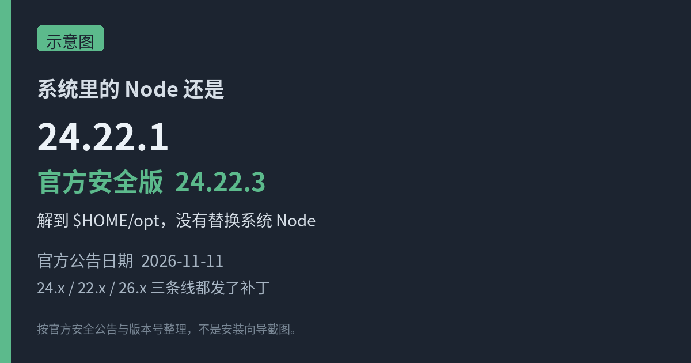
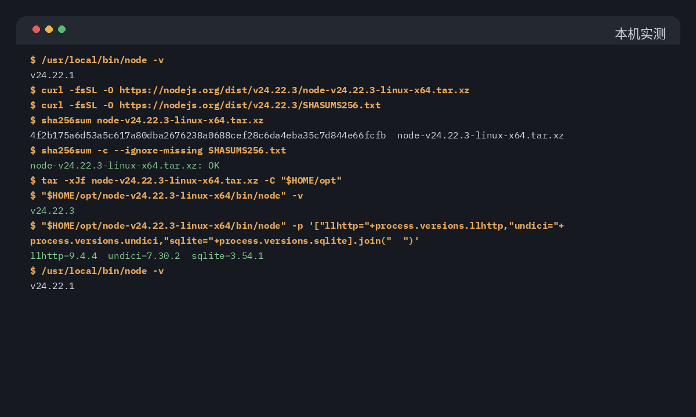

这台 Linux 上，`/usr/local/bin/node -v` 今天还是 **v24.22.1**。Node.js 项目在 2026-11-11 发了一轮安全更新，[官方公告](https://nodejs.org/en/blog/vulnerability/november-2026-security-releases)写明补丁版本是 **v22.23.5**、**v24.22.3**、**v26.13.1**。[24.22.3 的发布页](https://nodejs.org/en/blog/release/v24.22.3)标题也写成：2026-11-11，Version 24.22.3 'Krypton' (LTS)。

我没去复现这些漏洞，也没有替换系统里的 Node。下面只对照官方公告，再加上我在这台机器上把官方 linux-x64 包解到用户目录的过程。



<small>示意图，按官方安全公告和版本号整理，不是安装向导截图。</small>

## 公告里几条比较扎眼的 High

完整条目在上面那篇[11 月 11 日的安全公告](https://nodejs.org/en/blog/vulnerability/november-2026-security-releases)里。我按官方 Impact 原意转述，细节和复现步骤不去写。

跟 **HTTP/2** 有关的几条 High：未认证的客户端可能让服务器进程退出（CVE-2026-123863，官方写影响 24.x、26.x）；也可能造成内存和文件描述符泄漏（CVE-2026-123865，22.x、24.x、26.x），或把响应内存泄漏给对端（CVE-2026-123866，22.x、24.x、26.x）。另有一条是提供文件时可能发生内存损坏（CVE-2026-123874，24.x、26.x）。

跟 **HTTPS / TLS** 有关的几条同样扎眼：未认证的客户端可能读到其他连接的内存，官方写明包括 TLS 私钥和其他用户的请求；明文的 `node:http` 不受影响（CVE-2026-123864，22.x、24.x、26.x）。TLS 服务器还可能因未捕获的异常而退出（CVE-2026-126051，24.x、26.x）。如果按主机名区分了客户端证书策略，TLS 1.2 重协商可能导致认证被绕过（CVE-2026-123872，22.x、24.x、26.x）。

公告里还有若干 Medium、Low，以及 llhttp、undici、sqlite 的依赖更新。我没有逐条展开，要核对请直接打开那篇公告。这台机器走的是 24.x（LTS 名是 Krypton），对应补丁就是 **24.22.3**。

## 校验官方包，解到 $HOME/opt

二进制和校验文件都在 [Node.js 的官方发行目录](https://nodejs.org/dist/v24.22.3/)里。我用的是 `node-v24.22.3-linux-x64.tar.xz`，以及同一目录的 `SHASUMS256.txt`。没有动 `/usr/local/bin/node`，解压目标是 `$HOME/opt`。

```bash
curl -fsSL -O https://nodejs.org/dist/v24.22.3/node-v24.22.3-linux-x64.tar.xz
curl -fsSL -O https://nodejs.org/dist/v24.22.3/SHASUMS256.txt
sha256sum node-v24.22.3-linux-x64.tar.xz
sha256sum -c --ignore-missing SHASUMS256.txt
tar -xJf node-v24.22.3-linux-x64.tar.xz -C "$HOME/opt"
"$HOME/opt/node-v24.22.3-linux-x64/bin/node" -v
```

`sha256sum` 对上的是官方清单里这一行：`4f2b175a6d53a5c617a80dba2676238a0688cef28c6da4eba35c7d844e66fcfb  node-v24.22.3-linux-x64.tar.xz`，结果是 **OK**。这里用了 `--ignore-missing`，因为官方 `SHASUMS256.txt` 里还列着其他平台的包，我没下载那些文件；不加这个参数的话，校验会抱怨缺文件。官方目录里还有 `SHASUMS256.txt.asc`，这次我只核对了 SHA256，没有再验 PGP 签名。

新解开的二进制报的是 **v24.22.3**。我又用 `process.versions` 看了公告里点名的那几个依赖：llhttp **9.4.4**、undici **7.30.2**、sqlite **3.54.1**。系统里那份 24.22.1 仍是 llhttp 9.4.3、undici 7.30.1、sqlite 3.53.4。openssl 两边都是 3.5.9，nghttp2 都是 1.70.0。最后再跑一次 `/usr/local/bin/node -v`，还是 **v24.22.1**，系统路径没有被改掉。



<small>本机实测，命令和输出均来自这次在 Linux 上的安装过程；不是合成截图。</small>

个人 VPS 若要把新版本接到日常命令，可以把 `$HOME/opt/node-v24.22.3-linux-x64/bin` 加进自己的 `PATH`。这台机器上还有别的流程在用系统 Node，我就只把包留在用户目录里，没有改全局 `PATH`，也没有覆盖 `/usr/local/bin/node`。

我的理解（推断）：跑 Node 服务、尤其是对外开了 HTTP/2 或 HTTPS 的，优先把对应发行线升到这次公告里的补丁版本。至于某台机器是不是正在被打，官方没说，我也没条件去验证，别把这篇当成出事通报。
