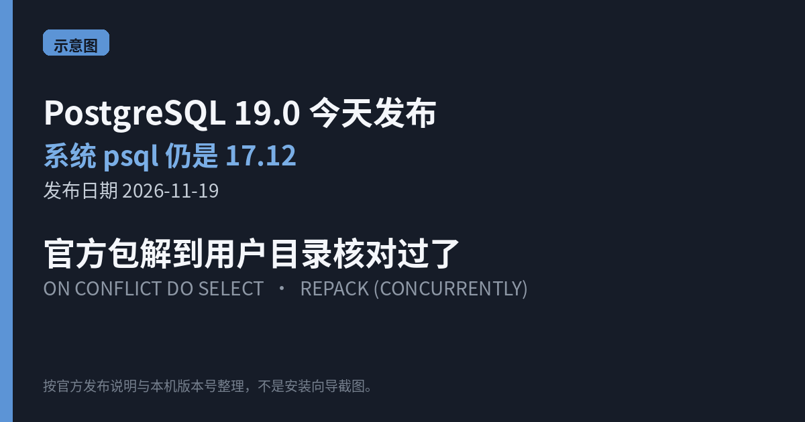
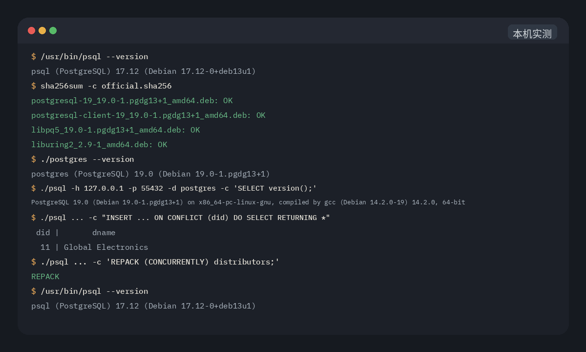

[PostgreSQL 官方新闻](https://www.postgresql.org/about/news/postgresql-19-released-3449/) 写明：2026-11-19，PostgreSQL Global Development Group 发布了 **PostgreSQL 19**。[19 的发行说明](https://www.postgresql.org/docs/19/release-19.html) 第一行也是 Release date: **2026-11-19**。页面上没有更精确的钟点。

这台 Debian 13 上，系统里的 `/usr/bin/psql --version` 今天还是 **psql (PostgreSQL) 17.12 (Debian 17.12-0+deb13u1)**。我没有用 apt 安装 19，也没有改系统里的客户端。下面这些步骤都发生在 `$HOME/opt/postgresql-19-check-20261119`，用来核对官方说明里的两条新语法能不能在解出来的官方包上跑通。



<small>示意图，按官方发布说明与本机版本号整理，不是安装向导截图。</small>

## 公告里比较扎眼的几处

完整清单在上面那篇发行说明里。我按官方概述转述，没有去复现其中每一条。

管理这边，19 新增了 **`REPACK`**，用来回收表里的空间、重排内容；带上 **`REPACK (CONCURRENTLY)`** 时，官方写明可以在不阻塞对该表读写的情况下进行。查询计划方面，新增 `pg_plan_advice` 和 `pg_stash_advice` 两个扩展。逻辑复制这边，官方写在 `wal_level` 为 `replica` 时，不必再为了打开逻辑复制而重启服务器；还可以复制 sequence 的值。给从库读的应用加了 “read-your-writes” 一致性，发行说明概述写成新的 **`WAIT`** 命令，新闻稿里则写成 **`WAIT FOR LSN`**。这些我都没有在这次实验里去搭复制环境。

开发这边，官方点名了 **`INSERT ... ON CONFLICT DO SELECT`**：冲突时可以由 `RETURNING` 返回已经存在的行，少一次往返。`COPY` 现在能以 JSON 输出。另外还写了外键检查更快、I/O worker 数量可以自动伸缩等性能变化。这些数字是官方测试的说法，我没有自己去做对比。

从旧版本迁到 19，发行说明要求用 `pg_dumpall`、`pg_upgrade` 或逻辑复制。这篇不是迁移指南，下面只核对我实际跑过的两条语句。

## 校验官方包，解到用户目录

二进制来自官方 [PGDG apt 仓库](https://apt.postgresql.org/pub/repos/apt/)。我用的是 trixie-pgdg、面向 Debian 13 的 **19.0-1.pgdg13+1**：`postgresql-19`、`postgresql-client-19` 和 `libpq5`。SHA256 对的是同一仓库 `dists/trixie-pgdg/main/binary-amd64/Packages.gz` 里的值，这个索引文件的 Last-Modified 是 2026-11-19 11:31:25 GMT，换到新加坡时区（UTC+8）是 **2026-11-19 19:31:25**。我只核对了 SHA256，没有再验仓库签名。

解开 `postgres` 之后，`ldd` 少一个 **liburing.so.2**。该包的 Depends 里写了 `liburing2 (>= 2.5)`，这台机器上没有安装这个系统包。我另外从 [Debian trixie 官方池](http://deb.debian.org/debian/pool/main/libu/liburing/) 下了 `liburing2_2.9-1_amd64.deb`，SHA256 对的是官方 Packages 和 [packages.debian.org 下载页](https://packages.debian.org/trixie/amd64/liburing2/download) 上同一条：`4b589c00c7a51172aace2cb2fb3d3ff32daf86c644023126dcfcaa840cc941ea`。同样只解到临时目录，没有 `apt install`。

```bash
dpkg-query -W liburing2 || true
/usr/bin/psql --version
# 下载官方 deb 后：
sha256sum -c official.sha256
dpkg-deb -x postgresql-19_19.0-1.pgdg13+1_amd64.deb root
dpkg-deb -x postgresql-client-19_19.0-1.pgdg13+1_amd64.deb root
dpkg-deb -x libpq5_19.0-1.pgdg13+1_amd64.deb root
dpkg-deb -x liburing2_2.9-1_amd64.deb root
export LD_LIBRARY_PATH="$PWD/root/usr/lib/x86_64-linux-gnu"
BIN="$PWD/root/usr/lib/postgresql/19/bin"
"$BIN/postgres" --version
"$BIN/initdb" -D "$PWD/pgdata" -L "$PWD/root/usr/share/postgresql/19" --auth-local=trust --auth-host=trust --no-sync --locale=C.UTF-8 --encoding=UTF8
# postgresql.conf：listen_addresses='127.0.0.1'，port=55432
"$BIN/pg_ctl" -D "$PWD/pgdata" -l "$PWD/pg.log" -w start
"$BIN/psql" -h 127.0.0.1 -p 55432 -d postgres -c 'SELECT version();'
```

`sha256sum -c` 的结果都是 **OK**。解开的 `postgres --version` 和 `psql --version` 都是 **19.0 (Debian 19.0-1.pgdg13+1)**。`SELECT version();` 打出来的是：

`PostgreSQL 19.0 (Debian 19.0-1.pgdg13+1) on x86_64-pc-linux-gnu, compiled by gcc (Debian 14.2.0-19) 14.2.0, 64-bit`

进程只监听 **127.0.0.1:55432**。实验结束后用 `pg_ctl stop` 关掉，系统里的 `/usr/bin/psql --version` 仍是 **17.12**。

## 两条新语法我实际跑过

[INSERT 文档](https://www.postgresql.org/docs/19/sql-insert.html) 里的例子是一张 `distributors` 表。我按同样的列建表，先插入 `(11, 'Global Electronics')`，再插入冲突的 `(11, 'Other Name')`，语句是 `ON CONFLICT (did) DO SELECT RETURNING *`。返回的还是原来那一行 **Global Electronics**，表里也只有这一行，没有被改成 Other Name。

[REPACK 文档](https://www.postgresql.org/docs/19/sql-repack.html) 的写法是 `REPACK [ ( option [, ...] ) ]`。我对这张表执行了 `REPACK (CONCURRENTLY) distributors;`，客户端回的是 **REPACK**，随后 `SELECT` 仍能读到原来的两行。这只说明这条语句在这个临时集群里能跑完，不是性能对比。



<small>本机实测，命令和输出均来自这次在用户目录里的核对；不是合成截图。</small>

发行说明里的 `pg_plan_advice`、逻辑复制和 `WAIT`，这次没有去搭。主包里能看到 `pg_plan_advice.so`，但没有对应的 control 文件，`CREATE EXTENSION` 会失败，我就没有再往下追。

我的理解（推断）：如果只是想先看 19.0 的官方包和这两条新语法，可以把 PGDG 的 deb 解到自己的目录里跑，不必先动系统里的 17。真要把现有数据迁过去，还是得按发行说明里的 `pg_dumpall`、`pg_upgrade` 或逻辑复制来，这篇不是迁移步骤。某台机器该不该升，得看你自己的扩展和业务，官方没替你做决定。
