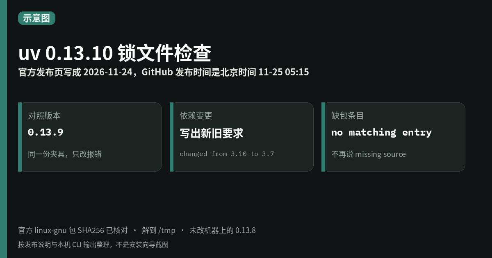
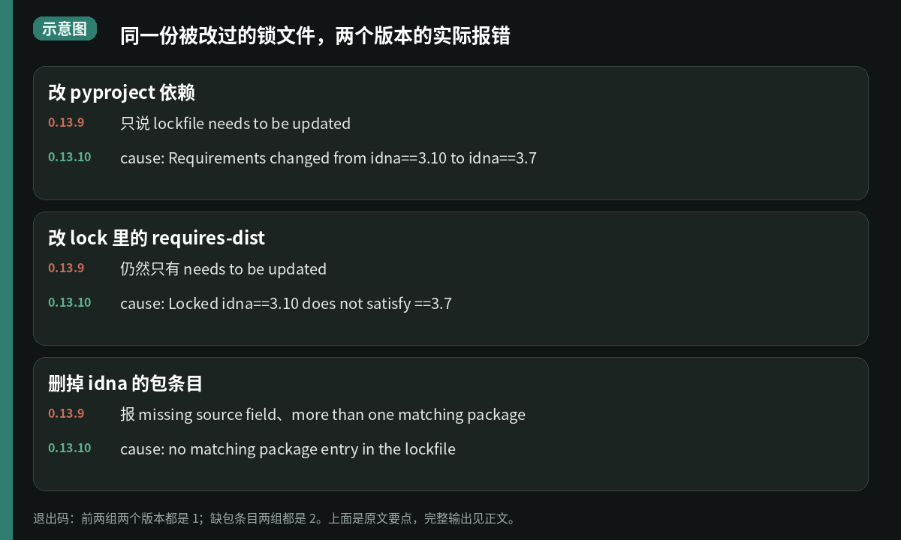

[uv 0.13.10 的 GitHub 发布页](https://github.com/astral-sh/uv/releases/tag/0.13.10) 把发行说明写成 **Released on 2026-11-24**。接口里的 published_at 是 **2026-11-24T21:15:44Z**，换成北京时间是 **2026-11-25 05:15**。这台机器上原先就有 `/usr/local/bin/uv`，版本是 **0.13.8**，我没动它，也没有执行官方文档里的 `curl … | sh`。

我从 [Astral 的正式发布目录](https://releases.astral.sh/github/uv/releases/download/0.13.10/uv-x86_64-unknown-linux-gnu.tar.gz) 下了 `uv-x86_64-unknown-linux-gnu.tar.gz`，对照同一目录里的 [sha256 文件](https://releases.astral.sh/github/uv/releases/download/0.13.10/uv-x86_64-unknown-linux-gnu.tar.gz.sha256)：

```
bf65ac1a0af10f92c522d91ac096c7c0a39657647b155577e7836c2cbbb4526c  uv-x86_64-unknown-linux-gnu.tar.gz
```

校验通过后，只解到 `/tmp/uv-0.13.10-check-20261125`。`./uv --version` 打印的是 `uv 0.13.10 (x86_64-unknown-linux-gnu)`。为了看报错到底改了什么，我用同样方式下了 [0.13.9](https://github.com/astral-sh/uv/releases/tag/0.13.9) 的 linux-gnu 包，官方校验和是 `a7fbaff2b9a271d85c1bdb540941090fd1ce011797b4abeb48e4dcd39c2471d5`，发布页写 **Released on 2026-11-17**，published_at 折合北京时间是 **2026-11-17 17:57**。`./uv --version` 是 `uv 0.13.9 (x86_64-unknown-linux-gnu)`。

实验时把 `HOME`、`UV_CACHE_DIR`、`UV_PYTHON_INSTALL_DIR`、`UV_TOOL_DIR` 和相关 XDG 目录都指到这个临时目录里，并用 `--python /usr/bin/python3` 指定已经在系统里的 CPython 3.13.5。测完没有留常驻进程，也没有往真实的 `~/.cache/uv` 写这次的缓存。

发行说明开头写：这个版本处理了 [GHSA-vjvj-3m3f-fgmm](https://github.com/astral-sh/uv/security/advisories/GHSA-vjvj-3m3f-fgmm)。官方把严重程度标成 low，并写 0.13.10 会拒绝数据描述符里的压缩大小和中央目录不一致的 ZIP 成员。我没有去构造这类归档，下面只核对同一页里三条和锁文件有关的增强。



<small>示意图，按官方发布页、校验和与本机 CLI 输出整理，不是安装向导截图。</small>

## 先锁一份只依赖 idna==3.10 的小项目

我在临时目录里写了一个名叫 `lockcheck` 的项目，`pyproject.toml` 里只有这一条依赖：`idna==3.10`。用 0.13.10 执行 `uv lock --python /usr/bin/python3`，输出是：

```
Using CPython 3.13.5 interpreter at: /usr/bin/python3
Resolved 2 packages in 104ms
```

生成的 `uv.lock` 里，`idna` 的版本是 3.10，项目自己的 `[package.metadata]` 写成 `requires-dist = [{ name = "idna", specifier = "==3.10" }]`。这份完好的锁文件，0.13.10 和 0.13.9 的 `uv lock --check` 都是退出码 0。

接下来的三组测试，都是在这份锁文件上改一处，再分别用两个版本跑 `uv lock --check`。改完就恢复，没有把故意弄坏的锁文件留下来。

## 依赖改了，新版本会把新旧要求写出来

我把 `pyproject.toml` 里的依赖改成 `idna==3.7`，锁文件仍锁定 3.10。0.13.9 只说锁文件需要更新：

```
Resolved 2 packages in 2ms
error: The lockfile at `uv.lock` needs to be updated, but `--check` was provided.

hint: To update the lockfile, run `uv lock`.
```

0.13.10 多了一行原因：

```
Using CPython 3.13.5 interpreter at: /usr/bin/python3
Resolved 2 packages in 47ms
error: The lockfile at `uv.lock` needs to be updated, but `--check` was provided.
  cause: Requirements for `lockcheck==0.1.0` changed from `idna==3.10` to `idna==3.7`

hint: To update the lockfile, run `uv lock`.
```

这就是发布说明里写的：当 `--locked` 拒绝锁文件时，说明它为什么要更新。我又用 0.13.10 跑了一次 `uv sync --locked --no-install-project`，报错同样带上了这一行 `cause`。需要说实话的是：这条命令还是先在临时目录里建了一个虚拟环境，`pyvenv.cfg` 写着 `uv = 0.13.10`，随后因 `--locked` 失败退出；`site-packages` 是空的，项目依赖没有装进去。我没有再用它跑任何服务。

`lock --check` 在对照 `idna==3.7` 时，会去解析新的要求，所以隔离缓存里出现了 3.7 的元数据。这不是一次安装，我也没有把 3.7 装进环境。

## 锁文件里的要求和锁定版本对不上时，原因不再是一句空话

第二组我没改 `pyproject.toml`，只把 `uv.lock` 里 `[package.metadata]` 的 specifier 改成 `==3.7`，包条目的 `version` 仍是 3.10。0.13.9 还是那句 “needs to be updated”，没有更细的原因。0.13.10 写成：

```
error: The lockfile at `uv.lock` needs to be updated, but `--check` was provided.
  cause: Locked `idna==3.10` does not satisfy `==3.7`.

hint: To update the lockfile, run `uv lock`.
```

这对应发布说明里的第一条增强：检查 `uv.lock` 里记录的依赖要求，是否和锁定的包版本一致。

## 删掉包条目之后，报错也不再指去一个不存在的 source 字段

第三组我删掉了 `uv.lock` 里整个 `idna` 的 `[[package]]` 段，但 `lockcheck` 的 `dependencies` 和 `requires-dist` 还指着它。0.13.9 的解析失败是这样写的：

```
error: Failed to parse `uv.lock`
  cause: Dependency `idna` has missing `source` field but has more than one matching package
```

这一份锁文件里其实已经没有 `idna` 的包条目，更谈不上多个匹配，也没有机会去看它的 `source` 字段。0.13.10 改成了更直接的一句：

```
error: Failed to parse `uv.lock`
  cause: Dependency `idna` has no matching package entry in the lockfile
```

这就是发布说明里第三条：把锁文件中缺少对应包条目的依赖报出来。0.13.9 那种写法我只按实际输出记下，不去替它解释内部实现。



<small>示意图，按两个官方二进制对同一份夹具的实际输出整理，不是产品界面截图。</small>

这三条都是锁文件检查，不是升级教程。机器上的 0.13.8 还在原处。隔离目录测完就停，没有改共享环境，也没有安装系统包。
