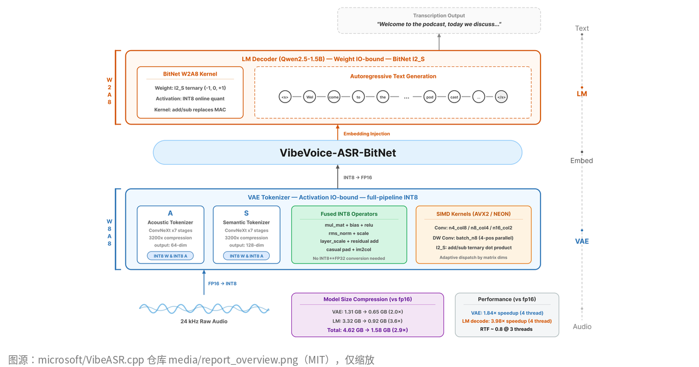
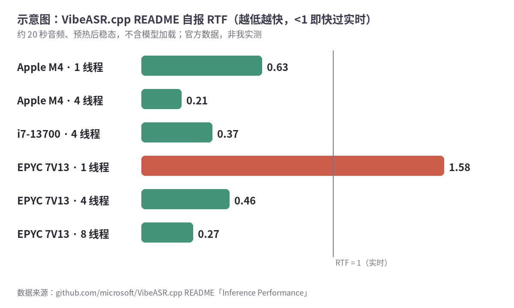

本地语音转写，大家默认想到的是 Whisper。微软 7 月放出来的 [VibeASR.cpp](https://github.com/microsoft/VibeASR.cpp) 走的是另一条路：把自家的 VibeVoice-ASR 模型压成 BitNet 那套 1–2 bit 权重，专门在 **CPU** 上跑。

先说清楚：我没在自己的机器上编过、跑过它，下面的数字全部出自官方 README、Hugging Face 模型页和技术报告。



<small>图：[microsoft/VibeASR.cpp 仓库 media/report_overview.png](https://github.com/microsoft/VibeASR.cpp/blob/main/media/report_overview.png)，仓库 MIT 许可，只缩放加了白边。</small>

## 它到底是啥

一句话：[VibeVoice-ASR-BitNet](https://huggingface.co/microsoft/VibeVoice-ASR-BitNet) 这个模型的官方推理程序，C++ 写的，底子是 llama.cpp 那套 GGUF 量化。仓库和模型都是 [MIT 许可](https://github.com/microsoft/VibeASR.cpp/blob/main/LICENSE)，仓库建于 2026-07-23，模型页 7 月 24 日上线，GitHub 上目前 270 多 star，没有打 release。

压缩的思路，README 写得挺直白：

- 把原来的 Qwen2.5-7B 语言模型换成 Qwen2.5-1.5B，再把权重压成三值（-1、0、+1）的 I2_S，音频那头的 VAE 压成 INT8。
- 总大小 **4.62 GB → 1.58 GB**。
- 代价是词错率（WER）绝对值涨 **1–4 个点**。

它跟微软 [VibeVoice](https://github.com/microsoft/VibeVoice) 是一家：大仓库里的 VibeVoice-ASR 号称一次吃 60 分钟音频，还会分说话人、打时间戳；VibeASR.cpp 是那条线往"笔记本也能跑"的方向砍了一刀。

## 官方说有多快

README 用 RTF（实时率）衡量：处理时间除以音频时长，小于 1 就是比实时快。测的是约 20 秒的片段，预热一次后取稳态，不算加载模型的时间。

- **Apple M4**（16 GB）：1 线程 0.63，4 线程 **0.21**。
- **Intel i7-13700**（Windows 11 + MinGW）：4 线程 0.37。
- **AMD EPYC 7V13**：单线程 1.58，慢过实时；4 线程 0.46，8 线程 0.27。README 还说同线程下比 Whisper.cpp 快 2.1–2.7 倍。



<small>示意图，我按 [README「Inference Performance」](https://github.com/microsoft/VibeASR.cpp#inference-performance) 表里的数字画的，非官方图，也不是我实测。</small>

我去，M4 单线程都能比实时快，这个要是真能复现，开会录音转文字基本不用等。可 20 秒的片段跟一小时会议是两码事，长音频表现 README 没单独给。

## 准确率别只看一行

README 的 WER 表挺长。英文的 MLC-EN、AMI 会议录音这些，BitNet 版比 Whisper、Parakeet 低（越低越好）；但 LibriSpeech、Fleurs-en 这类朗读语料，Parakeet、Whisper 反而更低。

中文要多看一眼：Fleurs-zh 上 BitNet 版 8.35，SenseVoice 5.56、FunASR 7.00；AISHELL-4 会议数据 27.45，比 FunASR 的 20.41 差一截。README 自己也加了注：带口音、方言的语音可能掉得更多。

所以我的理解（推断）：它的卖点是**小、快、CPU 能跑**，不是中文最准。纯中文场景，先别急着把 SenseVoice、FunASR 换掉。

## 想试的话

要求写得很少：Python 3.9+、CMake 3.14+、支持 C++11 的 GCC 或 Clang，约 2 GB 硬盘。官方给的一条龙：

```bash
git clone --recursive https://github.com/microsoft/VibeASR.cpp.git
cd VibeASR.cpp
pip install -r requirements.txt
python setup_env.py
```

装完有命令行 `asr_infer`，也有 Gradio 网页 demo。不想装的，[Hugging Face 上有在线 Demo](https://huggingface.co/spaces/microsoft/vibevoice-asr-bitnet-demo)。

Windows 有个坑：**不支持 MSVC**，CMake 直接拒，得用 MinGW-w64 的 GCC 或 Clang，`setup_env.py` 在 Windows 上也别用，按 README 的手动命令编。

技术细节在 [arXiv 2607.21075](https://arxiv.org/abs/2607.21075)。最后一次推送是 9 月 15 日，没有 release 版本号，想长期用的话，这点心里有数就行。
