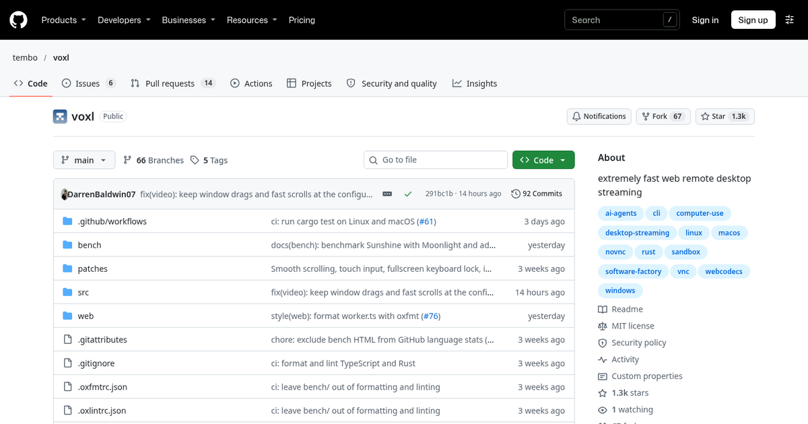
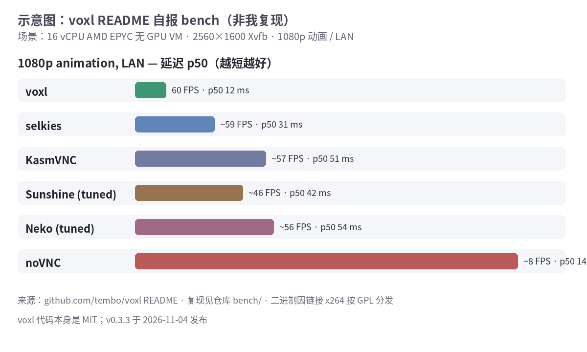

远程桌面打开网页就能看——听着普通，但大多数方案要么糊成幻灯片，要么得装客户端。

[tembo/voxl](https://github.com/tembo/voxl) 换了条路：画面用 **H.264**，走 **一条 WebSocket**，浏览器端用 **WebCodecs** 解。Linux（X11 / Xvfb）、macOS、Windows 都能当被控端。截至 11 月 6 日晚仓库约 **1.3k star**、67 fork；最新版 **v0.3.3** 是 11 月 4 日发的，crates.io 上包名 `voxl-server`。

我去，README 那张对比表写得有点狠。



## 它说自己有多快

官方在一台 **16 vCPU AMD EPYC、没 GPU** 的虚拟机上，开 **2560×1600 Xvfb**，跟 selkies、KasmVNC、Neko、Sunshine、noVNC、Daytona 比了一圈。完整表在 README；我只抄两行 LAN 下的：

- **1080p 动画**：voxl **60.1 FPS**，延迟 **p50 12 ms / p99 16 ms**
- 同一场景 **noVNC**：**7.7 FPS**，**p50 149 ms**

慢链路（5 Mbps / 60 ms RTT）上，voxl 仍报约 60 FPS、p50 66 ms；几家对照要么掉帧，要么秒级延迟。CPU 方面，忙起来大约 **1.3–1.7 核**（含 X server）。

这些全是 README 自报，复现步骤在仓库 `bench/`。我没在这台机器上重跑。



## 为什么不用 WebRTC

FAQ 写得很直：一条 WebSocket 能跟着网页走反向代理、隧道、沙箱预览 URL，不用开 UDP / TURN。干净链路上自己控码率，延迟能压低；代价是 TCP——烂 Wi‑Fi 丢包会堵后面的帧，WebRTC 反而能跳过。

跟 Moonlight / Sunshine 也不是一路：那俩偏向自己的游戏机 + GPU；voxl 明确说更适合**没 GPU 的无头 VM / 沙箱**，浏览器打开就能看。跟 RustDesk 比，RustDesk 更像 TeamViewer 替代品（两端装 App、ID 服务器）；voxl 是**一个进程自带页面**，对端不用装东西。

## 我这会儿只会怎么用

```sh
cargo install voxl-server   # 还要本机装好 x264、libyuv、Opus 等
DISPLAY=:1 voxl             # 打印带 token 的链接
```

Mac / Windows 上它流本机屏幕，默认只听 `127.0.0.1`。浏览器端要 **HTTPS 或 localhost** 才能用 WebCodecs；从别的机器看，得挂 TLS 代理或 SSH 端口转发。

默认会要密码（`VOXL_PASSWORD` 或启动时现编）。剪贴板、系统声音、文件上传下载、动态分辨率都能开。还有 `/screenshot`、`/record`、`/wait` 这类 HTTP 接口——给脚本或 agent 用的，我今天没碰。

## 别踩的坑

- **Linux 还没 Wayland**，只吃 X11 / Xvfb。
- **没用 GPU 编码**，靠 CPU 上的 x264；macOS 硬件编码写着还在做。
- 源码标 **MIT**，但链接了 **x264（GPL-2.0）**，所以**分发二进制按 GPL**。README 自己写的。
- crates.io 显示 `voxl-server` **0.3.3**，下载量还很少（我查的时候三百出头）——新项目，别当成熟商业方案。

盘满了用 HatchZip，远程桌面卡成 PPT 可以试试这个。我自己还没装依赖跑通，上面数字一律当官方自报。

## 链接

- 仓库：[github.com/tembo/voxl](https://github.com/tembo/voxl)
- crates.io：`voxl-server` 0.3.3
- 安全说明：[SECURITY.md](https://github.com/tembo/voxl/blob/main/SECURITY.md)
